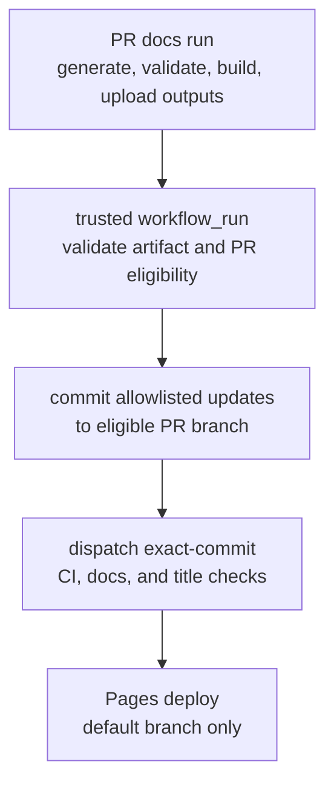

# Documentation suite specification

**Current implementation status:** The searchable VitePress site is published on GitHub Pages at the canonical URL below. It includes generated TypeScript, Python, and engine references in the Pages artifact, source-linked package guides, tested editor quick-start and edit/export workflows, one face-drafting workflow, two sketch-constraint workflows, generated format/configuration/CLI/MCP references, Mermaid rendering, accessibility and browser smoke checks, and a repository-controlled historical inbound-link inventory. The face-drafting guide's browser acceptance covers one supported inspector case: face 1, local +Z pull axis, and -5°; it captures a screenshot of the applied result. This single case does not establish broad face/axis/angle support. The sketch-constraints guide has browser acceptance for Parallel and Perpendicular workflows in `tests/browser/sketch-parallel-constraint.test.mjs`, which captures screenshots in `docs/screenshots/sketch-parallel-constraint.png` and `docs/screenshots/sketch-perpendicular-constraint.png`. The Perpendicular workflow distorts one corner, selects the adjoining segments, applies the relation, and verifies a 90° result. These two cases do not establish full sketch-constraint or task-workflow coverage.

All maintained `docs/**/*.md` pages and staged generated package-reference pages require stable slug, title, audience, and owner front matter. Changed-source diagnostics report owning pages or missing ownership for selected public API and package source trees, including the TypeScript and Python example trees included in the package examples guide. The REST API guide maps its plate-and-holes workflow to `docs/examples/rest-hole-plate.mjs`; the import-inspect-export guide maps its workflow to `docs/examples/rest-import-inspect-export.mjs`. Selected editor sources now include `apps/web/src/components/SketchForgeEditor.tsx`, `apps/web/src/components/SketchWorkspace.tsx`, and `apps/web/src/lib/sketchConstraints.ts`; the editor component maps to both edit-and-export and sketch-constraints guides. Other editor/UI sources and symbols remain unmapped. The docs checker also enforces source/test/CI metadata for 23 supported-language runnable fences in maintained documentation: each fence must include its exact tracked source with linked test and CI command, or carry a concrete reasoned exemption. This bounded check does not cover other fence languages, all runnable content, or ownership for every content source.

The configuration registry/reference covers supported server/container, TypeScript/Python client, local MCP, and desktop runtime settings, including `SKETCHFORGE_DESKTOP_PORT`; omission checks compare declared rows with the tracked readers in those scopes. The REST API guide's plate-and-holes walkthrough and the import-inspect-export guide's STL workflow run from their included sources against temporary local project storage in the package integration lane; tests verify the boolean-cut result or imported triangles, positive mass properties, a non-empty STL export, and cleanup through project deletion. Other REST request examples remain unexecuted or exempt. `SKETCHFORGE_DESKTOP_DEV_URL` is a launcher-injected internal handoff and `NODE_PATH` is pass-through, so neither is a supported setting; other build, test, CI, launcher, and pass-through environment reads outside the declared inventory are out of scope. Pull-request docs CI generates references before validation and build; trusted writers refresh allowlisted outputs on eligible same-repository PR branches and create a repair PR when a successful default-branch docs run finds stale tracked output. Fork PRs and PRs changing workflow-control files use the generated artifact fallback and do not get an automated branch update. The REST operation registry contains 32 operations; generated OpenAPI describes 28 and explains why 4 remain omitted (the `OPTIONS` preflights). `POST /api/v1/mirrors`, `POST /api/v1/patterns`, `POST /api/v1/explode`, `POST /api/v1/imports`, and `POST /api/v1/exports` now have runtime-validated request, response, and reachable error contracts. `PATCH /api/v1/shapes` can rebuild a persisted sketch sweep from an updated profile and now has a runtime-backed contract for profile updates and face-color validation. Broader task-oriented workflows, all-language runnable-block coverage, and ownership coverage for other content sources remain open requirements. See the phases and acceptance criteria below for durable scope and evidence.
**Retained face-draft status:** `PATCH /api/v1/shapes` can store or clear one `faceDraft` on an exact retained sketch extrusion, single-solid sketch sweep, or plain single-region full-turn sketch revolve. Source-profile edits replay the draft only when exactly one planar face matches the saved source normal; missing or ambiguous matches fail atomically. `GET /faces?topology=exact` lists analytic B-rep revolve faces while the default face listing remains mesh-based. A different source face must be selected only after clearing the draft.

One supported treatment can follow a face draft: a full-turn single-region sketch revolve accepts one all-edge fillet or symmetric 45° all-edge chamfer; a single-loop sketch extrusion accepts one all-edge fillet or symmetric 45° all-edge chamfer; and a single-section, hole-free sketch sweep accepts one all-edge fillet or symmetric 45° all-edge chamfer. Changing only the face-draft angle on such a treated sweep replays source, draft, then treatment atomically; `.skf` round trips and subsequent profile edits preserve the updated draft, treatment, and IDs. Pull-axis and source-face edits on treated sweeps remain refused. Source-profile edits replay source, draft, then treatment atomically and refresh treatment history. The bounded sequences persist through `.skf` round trips. Relevant coverage includes `tests/unit/faceDraftSweepFilletRecompute.test.ts`, `tests/unit/faceDraftExtrusionFilletRecompute.test.ts`, `tests/unit/faceDraftFilletRecompute.test.ts`, `tests/unit/faceDraftChamferRecompute.test.ts`, and `tests/unit/apiV1ShapeRoundTrip.test.ts`. Selected-edge treatments, non-45° chamfers, a second treatment, and other draft/treatment combinations remain refused before writing. Changing only the face-draft angle on a treated single-loop sketch extrusion replays source, draft, then treatment atomically; `.skf` round trips and source-profile edits retain the treatment, IDs, and refreshed history. Changing only the pull axis while a treatment is retained on a single-loop sketch extrusion replays source, draft, then treatment atomically; `.skf` round trips and subsequent profile edits preserve the new axis, treatment, and IDs, while invalid axes roll back without writing. Source-face changes while treated remain refused; changing the selected source face still requires clearing the draft.

A retained prism draft on a sketch extrusion can be followed by one all-edge fillet or symmetric 45° chamfer; source-profile and draft-angle edits replay the draft before the treatment, while adding a prism draft after a treatment remains refused. Shelling is refused when persisted draft or treatment metadata exists. This bounded support does not establish general topology lineage, and the editor's arbitrary-shape face-draft workflow remains baked. The OpenAPI baseline is 28 of 32 operations; the four omitted operations are `OPTIONS` preflights.

**Scope:** Public product, developer, API, package, and operator documentation
**Hosting target:** GitHub Pages
**Canonical URL:** `https://constructorfleet.github.io/SketchForge-3D/` unless the repository is later configured with a custom domain

## Repository baseline

The current default branch builds a static VitePress site under
`/SketchForge-3D/`, with local search, canonical Markdown staging, local link
and include checks, generated package/CLI/shape/configuration/format/MCP
references, deterministic generated-output validation after regeneration, a local preview command,
and a GitHub Pages workflow. The GitHub Actions publishing source is configured,
and the published site is reachable at the canonical URL. Lower-case
compatibility routes preserve legacy paths. Built-site browser checks cover
keyboard navigation, focus, landmarks, headings, mobile navigation, search,
and narrow viewport reflow. A separate recurring external-link
report that uploads advisory JSON and Markdown artifacts; external failures do
not fail the required local docs check or site build. The Pages API's initial
404 was a temporary setup blocker, not current status. The app's
`scripts/build-static.mjs` remains separate and builds SketchForge for
Cloudflare Workers. Existing built-site tests check static output and generated
provenance. The browser smoke suite also checks the editor quick-start workflow.

The migration starts with useful maintained sources already in place:
`README.md`, `docs/REST_API.md`, `docs/SKF_PROJECT_FORMAT.md`,
`docs/PUBLISHING_CLIENTS.md`, `docs/TRANSLATIONS.md`,
`packages/sketchforge-client/README.md`,
`packages/sketchforge-engine/README.md`,
`packages/sketchforge-py/README.md`, and the MCP skill under
`docs/skills/sketchforge-mcp-skill/`. Preserve their inbound links and identify
which are canonical prose, package-registry readmes, or compatibility pages
before moving content. The TypeScript client, Python client, and engine are
separate packages; the published CLI entry points are declared by the client
package and Python project metadata, while root npm scripts are repository
developer commands. Do not present those root scripts as a standalone product
CLI.

| Audited gap or contradiction | Evidence and consequence for the first implementation phases |
| --- | --- |
| The initial audit found no complete REST operation contract; route behavior lived in individual `apps/web/src/app/api/v1/*/route.ts` handlers and `docs/REST_API.md` was explanatory prose and tables. | At the time of the initial audit follow-up, runtime request/response contracts and generated OpenAPI covered 18 of 32 registered operations. Current status is 28 of 32; the four omitted operations are `OPTIONS` preflights. |
| Configuration has no single schema for every runtime setting. Environment reads and defaults are distributed across API, storage, MCP, macro, and desktop modules. | The generated reference covers supported server/container, TypeScript/Python client, local MCP, and desktop settings. Tests compare registry rows against the tracked readers in those scopes and verify owners. `SKETCHFORGE_DESKTOP_PORT` is registered; `SKETCHFORGE_DESKTOP_DEV_URL`, `NODE_PATH`, and other build/test/CI/launcher/pass-through reads are outside the supported-settings inventory. The registry does not claim every `process.env` use is supported configuration. |
| The initial audit found a generic “the release version” value in the publishing-client table and a version mismatch between the README badge and manifests. | The publishing-client table now reads the Release Please manifest, verifies it against package manifests, and is refreshed by release automation. `docs:check` rejects stale or generic values. |
| Project-format documentation contained a camera-state contradiction. `docs/SKF_PROJECT_FORMAT.md` said camera state is preserved, then later said camera position is omitted, despite `cameraView` in the workspace model and round-trip test. | The generated `.skf` reference and maintained project-format guide now agree with the workspace model and round-trip coverage. |
| The public CLI surface differs from root developer scripts. `packages/sketchforge-client/package.json` declares `sketchforge-macro` and `sketchforge-mcp`; `packages/sketchforge-py/pyproject.toml` declares its `sketchforge-macro`. | `docs/CLI_REFERENCE.md` is generated from the published entry points and actual usage/help output. Keep root npm scripts separate as contributor commands. |
| At the initial audit, GitHub Actions did not publish documentation to Pages; it built/tests the app and deployed app content to Cloudflare separately. | The Pages workflow now builds and deploys the static documentation artifact from the default branch. Pages publication is no longer an unverified setup decision. |

The table records the original problems and their durable implementation
status. Remaining requirements are tracked in the phase and acceptance sections
below.

## 1. Objective

Build a public, searchable documentation site from the repository's code, package metadata, executable examples, and carefully bounded explanatory prose. Publish it as a static site on GitHub Pages. A change to a public interface or example should either update the generated documentation automatically or fail a required pull-request check when the source and documentation contract disagree.

The site must not create a second hand-maintained copy of API signatures, endpoint lists, CLI options, environment variables, shape fields, package versions, or runnable examples. Human-written explanations remain appropriate for concepts, design rationale, workflows, limitations, and troubleshooting; every factual listing that can be extracted from source must be extracted or checked against source.

VitePress 1.6.4 is the selected static-site tool and already satisfies the
project-site build and local-search requirements. The generated result must be
plain static assets and work under the GitHub Pages project-site path on a
clean build without secrets or production connectivity.

## 2. Audiences and outcomes

| Audience | They need to accomplish |
| --- | --- |
| New editor user | Install or open SketchForge, complete a first model, save it, and export it. |
| Experienced editor user | Find a workflow by task, understand supported operations and limitations, and recover from common failures. |
| API user | Configure a local/server deployment, authenticate, discover operations and schemas, and safely automate projects. |
| TypeScript or Python client user | Install the correct package, understand the client surface, and run a working macro. |
| MCP user | Configure local and remote MCP use, understand tool behavior, and see safe, tested examples. |
| Contributor | Find architecture and contribution guidance, run checks, and update documentation from its source. |
| Operator | Configure storage, tokens, deployment, backups, and supported runtime behavior. |

## 3. Information architecture

The navigation should follow user tasks and audience, not the repository's directory tree.

### Learn SketchForge

- Overview and capability map
- Quick start: open the editor, create a solid, edit it, save a project, and export a model
- Core concepts: shapes, sketches, workplanes, groups, baked operations, exact CAD data, project files, and undo/redo
- Task guides: sketch and extrude, import, modify, arrange, measure, inspect, save, and export
- Supported formats and known limitations
- Troubleshooting and common errors

### Automate SketchForge

- Automation overview and choosing REST, TypeScript, Python, or MCP
- Server setup and authentication
- REST API reference generated from the route contract
- TypeScript client reference generated from published declarations
- Python client reference generated from exported symbols and type/doc metadata
- Macro authoring and runner behavior
- MCP setup, tool reference, and examples
- Idempotency, revisions, errors, limits, and safe token handling

### Project files and formats

- `.skf` format overview and compatibility rules
- Generated schema/field reference from the project validators and serializers
- Import/export format matrix from supported format registries
- Asset layout, integrity checks, and migration/version behavior

### Build and operate

- Local development setup
- Configuration and environment variable reference generated from the configuration schema
- Storage, Docker, deployment, backup, and upgrade guides
- Architecture map and engine boundaries
- Contributing, quality gates, release process, and support policy

### Reference and release history

- Searchable API/package/CLI/config references
- Release notes sourced from `docs/CHANGELOG.md` or the canonical release metadata
- Glossary generated from the canonical term list, with explanatory definitions maintained once
- Version selector only if the project begins supporting more than one maintained docs version

The site must retain useful inbound links from the current `README.md`, `docs/REST_API.md`, `docs/SKF_PROJECT_FORMAT.md`, and package READMEs. During migration, publish redirects or compatibility pages for existing paths where feasible.

## 4. Source-of-truth rules

Each fact has one authoritative source. Site pages may include generated output or import source documents, but must not copy these facts into a parallel table.

| Information | Authoritative source | Generated output and CI behavior |
| --- | --- | --- |
| REST paths, methods, auth, query/body/response schemas, errors, limits | A typed API operation contract consumed or validated by each route handler | Generate OpenAPI and endpoint pages; contract tests exercise every registered operation against the running app. Fail on unregistered public routes or mismatched runtime behavior. |
| TypeScript client exports and signatures | Built `.d.ts` output from `packages/sketchforge-client` | Generate API reference from declarations; build package before site generation. |
| Python public symbols, types, and signatures | `packages/sketchforge-py/src` exports, annotations, and docstrings | Generate API reference from installed-package metadata/source; fail if examples import unavailable symbols. |
| Engine public API | `packages/sketchforge-engine/src/index.ts` and package export map | Generate package reference from declarations and exports; do not list internal modules as stable public API. |
| Shape kinds and accepted fields | Runtime shape definitions/validators and request types shared by browser and API | Generate shape catalog and field matrix; parity test browser, REST, TypeScript, and Python surfaces. |
| `.skf` structure and supported features | Validators, schema/version constants, serializer, importer, and migration code | Generate machine-readable schema and field reference; run round-trip and compatibility fixtures referenced by docs. |
| CLI commands and options | Actual command parser and package scripts that are part of the public CLI | Generate command pages from `--help` or parser metadata; compare examples to executable invocations. |
| Environment variables and defaults | Configuration registry plus authoritative readers | Generate a reference table including defaults, validation, security sensitivity, and affected subsystem. Reject undocumented settings within the tracked reader set; expand the set deliberately as supported scopes are added. |
| Executable code examples | Existing package examples, MCP examples, tests, and designated tutorial fixtures | Embed the source file or named region; typecheck/lint/execute the same file in the docs CI lane. No copied fenced blocks for runnable code. |
| UI labels and localized strings | English locale catalog and UI action/command registries | Generate labels and searchable command names where useful; prose explains intent and workflow. Check generated labels exist in the source catalog. |
| Release version and release notes | `package.json`, package manifests, tags/releases, and the canonical changelog | Inject version data at build time and import release notes from one canonical source. Fail if published package versions drift unexpectedly. |
| Concepts, rationale, workflows, limitations | Maintained documentation source | Require an owning page and review when relevant behavior changes; automated examples and capability assertions validate concrete claims. |

The API operation contract is the main required extraction seam. It should define a stable operation ID, route, method, authentication, schemas, response statuses, errors, limits, and examples. Route handlers must use the contract's validators or be covered by generated contract tests. A manually maintained OpenAPI file that merely resembles the implementation does not satisfy this spec.

Where the current implementation has no structured source to extract from, add the smallest shared registry/schema needed to establish one. Do not introduce a generator that parses arbitrary implementation details with brittle regular expressions.

## 5. Examples and tutorials

Examples are product behavior, not decorative text.

- Each code sample is included from a source file or generated from a test fixture using a stable directive such as `example: packages/sketchforge-client/examples/bolt-plate.macro.mjs#run`.
- The site build fails if a directive points to a missing file, missing symbol/region, or empty excerpt.
- TypeScript examples must typecheck against the currently built package. Python examples must import and run against the current package.
- REST examples run in a local integration job with temporary project storage and a generated test token. They must not call production services.
- MCP examples validate against the current tool schema and use temporary local fixtures or a local test server.
- The REST API plate-and-holes and import-inspect-export walkthroughs are included from `docs/examples/rest-hole-plate.mjs` and `docs/examples/rest-import-inspect-export.mjs`, and run against the temporary local server in `packages/sketchforge-client/tests/rest-hole-plate.integration.ts` and `packages/sketchforge-client/tests/rest-import-inspect-export.integration.ts`. Tests verify the boolean-cut result and the STL import → properties → export result, including project cleanup. The local-project MCP shell command is included from `docs/mcp/examples/run-local-project.sh`; its docs example check executes that same file and validates the resulting workflow output. Other REST walkthroughs and runnable fences are not covered by this bounded contract.
- Examples that create or mutate projects state their execution mode and cleanup behavior. Destructive examples must operate only on temporary data.
- Tutorial steps that describe editor behavior must have a behavioral acceptance check where feasible. Screenshots are captured from the current app workflow in a reproducible browser job; manually curated images are allowed for conceptual illustrations only and must be labeled as illustrations.
- Generated output records the source path and, in contributor diagnostics, the source line or symbol so a stale claim can be fixed at its origin.
- A test that exists only to demonstrate a code block is not copied into a second implementation; the documentation invokes that test fixture or example directly.

## 6. Site requirements

- Static HTML, CSS, JavaScript, search index, and assets; no runtime server or private environment variables.
- Correct project-site base path at `/SketchForge-3D/`, including deep links, search, images, CSS, and client-side navigation.
- Responsive layouts, keyboard navigation, semantic headings, visible focus, sufficient contrast, and useful alt text.
- Built-in search indexes page titles, headings, generated API symbols, and reference tables. Search works without third-party SaaS.
- Stable page slugs and redirects when pages move. External and internal links are checked in CI.
- Pages identify the documentation version/repository revision they describe and display the release version used for generated references.
- No page depends on fetching live application state during build or render.
- Support source links that point to the exact repository path and commit represented by a page.
- Images and downloads have explicit licenses/provenance and reasonable size budgets.
- Diagrams are authored as ```mermaid fences and rendered by the site; ASCII art is not a substitute. Fences are rendered client-side from the committed diagram source, so the diagram stays reviewable in the repository.

## 7. Build and publishing workflow

The site is produced by one ordered pipeline; every stage must pass before the
next one runs.



### Required commands

Expose stable repository scripts, independent of the chosen site generator:

```text
npm run docs:generate   # refresh generated references, stage canonical docs, and include examples
npm run docs:verify     # validate sources and the output produced by docs:generate
npm run docs:site-build # build and inspect the static Pages artifact
npm run docs:preview    # serve the artifact locally under the project-site base path
```

The build must be deterministic: two clean builds from the same commit and dependency lockfile produce equivalent output. Generated Markdown may remain tracked when repository browsing or compatibility requires it. Seven generators write tracked output: `docs/PUBLISHING_CLIENTS.md`, `docs/SHAPE_REQUEST_REFERENCE.md`, `docs/CLI_REFERENCE.md`, `docs/OPERATOR_CONFIGURATION.md`, `docs/SKF_FORMAT_REFERENCE.md`, `docs/mcp/TOOLS_REFERENCE.md`, and `docs/openapi-v1.json`; the package TypeScript, Python, and engine references are staged under `.docs-site/docs/reference/`. `docs/openapi-v1.json` is linked directly from `docs/REST_API.md`. Pull-request docs CI runs `docs:generate` before generated-output verification and the site build, then uploads generated output. A trusted `workflow_run` handler treats that artifact as untrusted input and validates the source run, PR, artifact manifest, and allowlist before writing only allowlisted paths. It commits changed generated files only to same-repository PR branches targeting the default branch and skips branches that change `.github/workflows/` or `.github/actions/` controls. Fork PRs and workflow-control changes retain the generated artifact as a fallback; no branch update is attempted for them. After an automatic commit (or when output is already current), the handler dispatches CI, docs, and title workflows with the exact resulting commit SHA, which each dispatched workflow verifies. The original docs run validates/builds the source PR head; these follow-up runs validate the resulting head after generated changes.

### Pull request checks

On every pull request that changes application code, packages, tests/examples, docs, or site tooling:

1. Install from the lockfile and build the public packages.
2. Generate API, configuration, shape, format, package, and CLI reference inputs.
3. Run every generator before freshness checks. The trusted PR workflow validates an artifact generated by docs CI and may commit changed allowlisted outputs to an eligible same-repository PR branch; it then dispatches CI, docs, and title checks against that exact resulting commit. Fork PRs and PRs changing workflow-control files use the generated artifact fallback instead of an automatic branch update. The original docs run validates/builds the source PR head, and the dispatched runs validate the resulting head after generated changes.
4. Verify source directives, internal links, fragments, redirects, and image references.
5. Typecheck and execute the examples described in section 5.
6. Run API route-registry parity, covered runtime contract tests, and project-format compatibility checks.
7. Build the static site with the exact `/SketchForge-3D/` base path.
8. Smoke-test representative deep links, search, and assets from the built artifact.

When practical, upload the built site as a pull-request artifact for reviewers. Do not deploy unmerged changes to the production Pages URL.

### GitHub Pages deployment

- Deploy only from the protected default branch after required checks pass.
- Use the official Pages artifact/deploy workflow with narrowly scoped `pages: write` and `id-token: write` permissions in the deployment job; all earlier jobs remain read-only.
- Configure repository Pages to use **GitHub Actions** as the publishing source.
- Set the Pages base path from repository metadata rather than duplicating a literal across configuration files.
- Use a concurrency group so an older deployment cannot overwrite a newer commit. Do not cancel a deploy after it has started publishing.
- Pin third-party GitHub Actions according to the repository's existing dependency/security policy.
- On deployment failure, keep the previous published site available and surface the failed commit and artifact link in Actions.
- No production secrets are needed to build or publish public documentation.

## 8. Content ownership and change policy

- Maintained `docs/**/*.md` pages and staged generated package-reference pages must have stable slug, title, audience, and owner front matter. `docs:verify` enforces these fields and unique, safe slugs. A reviewed revision is not currently required or checked.
- Each public code area maps to at least one reference page and one tested example or an explicit reason no example is appropriate.
- A pull request that changes public behavior must either update the source-derived reference automatically or update the owning concept/workflow page when user-facing explanation changes.
- Reviewers should reject manually copied signatures, endpoint lists, config tables, shape catalogs, and runnable code blocks when source directives or generators can provide them.
- A `docs:check` job should report the changed source symbol/route/config key and the owning page or missing example. The current `docs:verify` checker compares changed paths against owner-page `sources` patterns for `apps/web/src/app/api/v1/**`, the TypeScript client `src/**`, `examples/**`, and `mcp/**`, the engine `src/**`, and Python client `src/**` and `examples/**`. The package example trees map to `docs/guides/package-examples.md`, whose included examples are exercised by the package integration suites. It reports matching pages or fails with a missing-owner diagnostic for changed files in those scopes. It is path-level rather than symbol-level; source patterns are optional and checked only to ensure they match at least one tracked file, not that mappings are unique or semantically correct. It does not yet map editor/UI sources, other examples, tests, or other repository content sources to pages and runnable examples.
- Translate stable prose only after the English source and generated contract are current. Generated API signatures and code examples remain language-neutral; localized UI labels come from locale catalogs.

## 9. Migration plan

Deliver the suite in small steps while retaining current published docs until replacement coverage exists.

### Phase 1: establish the site and guardrails

- [x] Select VitePress 1.6.4; verify project base-path build support, built-in local search, source includes, static output, and Actions artifact deployment workflow.
- [x] Add site shell, navigation, base path derived from repository metadata, Pages workflow, local source/link checks, and local preview command.
- [x] Import tracked repository Markdown from canonical sources without rewriting factual tables.
- [x] Publish a migration map and retain repository-relative Markdown paths in the generated source tree.
- [x] Configure the repository Pages publishing source as GitHub Actions and verify the first published deployment.

Phase 1 established and deployed the static site shell. Generated package,
CLI, shape, operator-configuration, `.skf`, and MCP references; runtime-backed
REST contracts for a subset of operations; source provenance; legacy-path
compatibility; and deterministic local link/include checks are present. The
built-site browser checks cover keyboard navigation, visible focus, landmarks,
headings, mobile navigation, local search, accessible names, contrast, alt
text, reduced motion, and narrow viewport reflow. Broader task-workflow smoke
checks remain incomplete. External-link reporting is advisory; local link and
include failures are blocking.

The built-site browser test uses the pinned Playwright dependency. On a local
checkout, install its Chromium binary with `npm run docs:browser:install`
before `npm run docs:build`; the documentation workflow installs Chromium and
its Ubuntu system dependencies before running the build.

### Phase 2: generate package and example documentation

- The TypeScript client and engine references are built from declarations; the Python reference is built from public exports, annotations, and docstrings. Current generated package references are staged at `.docs-site/docs/reference/` and validated there for the Pages artifact. Package guide pages include the registry-facing READMEs as canonical prose.
- Python references include type checks and symbol-level source links. The API docs link to operation sources and examples; stable face IDs and face colors are available from the Python client.
- `docs/guides/package-examples.md` includes existing client and Python macro examples. Integration jobs execute those package examples against a local API. Browser acceptance covers the editor quick-start, the create, edit, save, reload, and export workflow in `docs/guides/edit-and-export-model.md`, one supported face-drafting case documented in `docs/guides/face-drafting.md` (face 1, local +Z, -5°) with screenshot evidence, and Parallel and Perpendicular constraint workflows in `docs/guides/sketch-constraints.md`. The Perpendicular case distorts a rectangle corner, selects the adjoining segments, applies the constraint, verifies the resulting 90° angle, and captures `docs/screenshots/sketch-perpendicular-constraint.png`; neither case proves full sketch-constraint support. Other face-drafting combinations and most task-oriented editor workflows remain untested.
- Build TypeScript and engine declaration references from the package build; generate Python references from public exports and annotations/docstrings; convert examples into source includes and execute them in CI.
- Reuse package README content for package registries and the site from a shared source or generated subset.

### Phase 3: make the REST reference authoritative

- `apps/web/src/lib/apiV1OperationContract.ts` registers every public route method and auth mode. A parity test compares the registry with discovered route handlers. The current baseline is 28 of 32 operations with runtime-backed request/response contracts in generated OpenAPI; the four omitted operations are `OPTIONS` preflights.
- All 28 non-OPTIONS resource operations have runtime schemas and response validation; only the four preflight-only OPTIONS handlers are omitted. The generator creates a Pages reference per resource operation with operation ID, method/path, auth, parameters, request body, responses, errors, and source links. `POST /interference` validates normalized IDs and finite nonnegative clearance, then validates its bounded exact/tessellated report and documented error responses against the runtime contract. `POST /parts` validates trimmed project/shape IDs and successful shape-summary responses at the route boundary. `POST /mirrors` validates normalized target IDs, principal-axis selection, successful shape summaries, and its reachable error responses. `POST /patterns` validates normalized IDs, linear/circular kind and defaults, integral count limits, finite numeric options, successful shape summaries, and reachable errors. `POST /explode` validates trimmed project and shape query IDs, assembly shape summaries and revision, and reachable errors when splitting a STEP product tree. `POST /imports` documents base64 JSON and multipart upload bodies, validates the stable shape/triangle-count/revision response, and checks reachable JSON errors at the route boundary. `POST /exports` documents format, shape-selection, naming, view and section constraints; it validates the JSON/base64 result or binary media type and metadata header for `download=1`, plus reachable errors. `PATCH /shapes` models face-color keys and hex values and validates successful profile updates and reachable errors.
- `GET /faces` exposes stable application-owned IDs, and `PATCH /shapes` accepts them as persisted `faceColors` keys. `GET /edges` documents current topology-order indexes for fillet/chamfer requests; those indexes can change when topology changes. `GET /properties` documents exact and tessellated mass-property provenance. `GET /thickness` documents its nullable sampled estimate, 25 samples per face, and 256-face limit. Measurement routes have query/body and response contracts.
- Sketch sweeps retain their source profile in `.skf`. The engine and both clients can create sweeps; `PATCH /api/v1/shapes` accepts an updated `sketchProfile` and rebuilds geometry while retaining shape and source IDs. Its runtime-backed OpenAPI contract includes face-color key/value rules and profile updates.
- General dependency-ordered recomputation across downstream operations remains outstanding.
- The typed operation contract is implemented in `apps/web/src/lib/apiV1OperationContract.ts`, with parity and route-backed validation tests.
- Generated OpenAPI and operation-level Pages references are produced from the same runtime-backed contracts; only the four preflight-only `OPTIONS` methods are omitted.
- Route registration parity and representative contract cases are enforced against the local app.
- `docs/REST_API.md` links to the generated operation index and retains conceptual explanations and runnable workflows; the generated pages own endpoint-specific schemas and status details.

### Phase 4: formats, configuration, CLI, and workflow guides

- The parameterized-shape, CLI, operator-configuration, `.skf`, and MCP references are regenerated from their code or metadata inputs before validation. Eligible same-repository PRs receive changed allowlisted tracked outputs automatically; output drift alone does not fail CI. STEP color guidance describes the supported import behavior.
- Package examples, the editor quick-start and edit/export workflow, one supported face-drafting case, and Parallel and Perpendicular constraint workflows are tested. Broader task-oriented guides and corresponding workflow checks remain outstanding.
- Structured registries and generated references cover parameterized shapes, supported server/container, desktop, client/MCP runtime settings, CLI entry points, project formats, and MCP tool schemas. The desktop inventory includes `SKETCHFORGE_DESKTOP_PORT`; launcher handoff, build/test/CI, and pass-through environment reads remain outside the supported-settings inventory.
- Generate references and add round-trip/command/tool smoke examples.
- Retain human-authored tutorials for context and task flow; embed live examples and generated UI labels.

### Phase 5: close the stale-content loop

- Add coverage rules for every public route, exported symbol, config key, format, and example.
- Scheduled, pull-request, and manual external-link reporting uploads advisory JSON and Markdown artifacts. Remote failures do not fail the deterministic local docs check or site build.
- Generated site pages show the package version, repository revision, and source links pinned to that revision. Compatibility routes cover legacy public paths, and release metadata consistency is checked.
- Complete coverage rules for every route, export, configuration key, format, and example remain outstanding.
- Remove superseded manually maintained tables and duplicate code blocks.

### Current documentation gaps

- **Publishing-client version — closed:** the table reads package versions from the Release Please manifest, checks them against package manifests, and is updated automatically during release preparation.
- **Cross-links between documentation and references — closed:** task guides, package pages, API references, and generated symbol references link to related concepts and are checked for local-link validity.
- **Engine package documentation — closed:** The npm README and generated engine reference explain that the full exact-CAD dependency stack requires Node.js 24 even though the package manifest declares `>=20`, map the public `Engine` operations, and state that callers must provide an existing project. Focused tests check the manifest/lockfile boundary, execute the example, and verify generated-reference content. Aligning the package manifest requires a release decision because it would drop Node.js 20 support.
- **Generated-output automation — implemented with limits:** PR docs CI generates before verification/build and uploads generated output. The trusted artifact-only PR writer commits allowlisted changes to eligible same-repository PR branches, then dispatches CI, docs, and title checks for the exact resulting commit SHA. After a successful default-branch docs build, a separate trusted writer validates outputs against the current main SHA and creates or refreshes a bot repair PR if tracked outputs differ; it never writes directly to protected `main`. Fork PRs and PRs changing workflow controls use the generated artifact fallback and require maintainers to apply any needed generated changes.
- **Task-oriented coverage and source/example ownership — open:** the REST API guide and import-inspect-export guide now provide two source-backed, integration-executed workflows (plate-and-holes and STL import → inspect → export); other REST walkthroughs remain unexecuted or exempt. The edit-and-export guide has browser acceptance, and the face-drafting guide has browser acceptance for one supported inspector case: face 1, local +Z, and -5°, with a screenshot in `docs/screenshots/face-draft-browser.png`. The sketch-constraints guide has browser acceptance for Parallel and Perpendicular workflows, with screenshots in `docs/screenshots/sketch-parallel-constraint.png` and `docs/screenshots/sketch-perpendicular-constraint.png`; the latter changes one corner so the adjoining segments start non-perpendicular, applies the constraint, and checks the result is 90°. These bounded cases do not cover all face-drafting combinations, sketch constraints, or task-oriented editor workflows. Supported server/container, desktop, TypeScript/Python client, and local MCP runtime settings have registry-backed rows with source and owner links, and omission checks cover their tracked readers. Desktop configuration ownership is met for `SKETCHFORGE_DESKTOP_PORT`, which has a registry row, implementation source, and owner page; launcher handoff and pass-through values remain outside the supported inventory. Stable ownership metadata is enforced for all maintained `docs/**/*.md` pages and staged generated package-reference pages. Changed-source-to-page diagnostics are implemented for the REST route tree, the REST guide's included `docs/examples/rest-hole-plate.mjs` fixture, TypeScript client source and MCP trees, engine source, and Python client source; they also map the TypeScript/Python example trees included in `docs/guides/package-examples.md`, whose examples run in existing integration suites. The editor sources mapped to the sketch-constraints guide are `SketchForgeEditor.tsx`, `SketchWorkspace.tsx`, and `sketchConstraints.ts`; `SketchForgeEditor.tsx` maps to both that guide and edit-and-export. Other editor/UI sources remain unmapped. A separate docs check covers 23 supported-language runnable fences in maintained docs: each must include its exact tracked source plus a test and CI command, or give a concrete reason for exemption. This does not cover other fence languages or prove all runnable content is exercised. Source diagnostics remain path-pattern based, permit overlapping matches, and only check changes within mapped roots; semantic ownership, other examples, and source symbols remain out of scope. End-to-end coverage from every changed source to its owning page and tested example remains open.
- **REST contracts and generated operation pages — met for resource operations:** all 28 non-OPTIONS resource operations have runtime-backed contracts and generated OpenAPI coverage; the four omitted operations are preflight-only `OPTIONS` handlers. Each resource operation has a generated Pages reference with its operation ID, method/path, authentication, parameters, request body, responses, errors, and route-source link.

## 10. Acceptance criteria

The suite is ready for general use when all of these are true. The status below
is based on the current workflows, generators, source documents, and tests; a
green narrow check does not imply that the broader requirement is complete.

1. **Met:** A clean CI checkout builds and previews the docs without secrets or production connectivity. The workflow installs lockfile dependencies and Python docs-check requirements before running the local pipeline.
2. **Met:** A default-branch merge deploys the built site to GitHub Pages at the configured canonical URL. The repository Pages source is GitHub Actions and the published URL is live.
3. **Met:** The site loads assets and deep links under `/SketchForge-3D/`; VitePress is configured for that project prefix and built-site tests serve and inspect the artifact under it.
4. **Met for resource operations:** route registration parity is enforced, and all 28 non-OPTIONS resource operations have runtime-backed request/response contracts and generated operation Pages references. The references include authentication, parameters, request content, response/error statuses, and handler source links. The four omitted operations are preflight-only `OPTIONS` handlers. `POST /api/v1/interference` contracts ID trimming/uniqueness, finite nonnegative clearance, exact/tessellated report precision, and bounded-limit errors. `POST /api/v1/parts` contracts trimmed target IDs and the shape-summary split response. `POST /api/v1/mirrors` contracts ID normalization, axis selection, its shape-summary response, and reachable errors. `POST /api/v1/patterns` contracts normalized IDs, defaults, count limits, finite numeric options, a 201 shape-summary response, and reachable errors. `POST /api/v1/explode` contracts trimmed target IDs, the STEP assembly shape-summary response and revision, and reachable errors. `POST /api/v1/imports` contracts both base64 JSON and multipart file uploads, its shape/triangle-count/revision result, and reachable errors. `POST /api/v1/exports` contracts request constraints, JSON/base64 and raw binary outputs, the download metadata header, and reachable errors. `PATCH /api/v1/shapes` supports `sketchProfile` rebuilds by output shape ID or persisted `sketchSourceId`, and its OpenAPI schema describes face-color key/value rules. It also stores or clears one `faceDraft` on an exact retained sketch extrusion, single-solid sketch sweep, or plain single-region full-turn sketch revolve and replays it after a source-profile edit only when exactly one planar face matches the saved normal; missing or ambiguous matches fail atomically. `GET /faces?topology=exact` lists analytic B-rep revolve faces while the default face listing remains mesh-based. The editor's arbitrary-shape face-draft workflow remains baked.
5. **Met for published references and the declared supported configuration inventory:** TypeScript, Python, engine, CLI, supported server/container, desktop (`SKETCHFORGE_DESKTOP_PORT`), TypeScript/Python client, local MCP settings, shape, MCP, and `.skf` references are generated or checked from declarations, exports, validators, readers, registries, or package metadata. Configuration omission checks compare registry entries with the tracked server/container, desktop, and client/MCP reader set. Build/test/CI, launcher handoff, pass-through, and other environment reads outside the declared supported inventory remain out of scope; not every environment variable is claimed to be supported configuration.
6. **Partial:** The TypeScript and Python package examples included in `docs/guides/package-examples.md` are sourced from repository files, mapped to that owning page, and exercised by their package integration suites; MCP examples are sourced and exercised in CI. The editor quick-start and create/edit/save/reload/export guide have browser acceptance. The face-drafting guide has browser acceptance for one supported inspector case (face 1, local +Z, -5°) with screenshot evidence. The sketch-constraints guide has browser acceptance for Parallel and Perpendicular workflows, with screenshot evidence in `docs/screenshots/sketch-parallel-constraint.png` and `docs/screenshots/sketch-perpendicular-constraint.png`. The Perpendicular workflow starts from a distorted corner, applies the relation to adjacent segments, and verifies a 90° angle. These narrow cases do not establish broad face/axis/angle support, all sketch constraints, or broader task-workflow coverage. The local-project MCP shell command is included from and executed as the same fixture. The REST API guide's plate-and-holes and import-inspect-export workflows are included from source files and exercised against the local API integration fixture; other REST snippets remain unexecuted or exempt. A docs check validates 23 supported-language runnable fences in maintained documentation: each has exact source inclusion with a named test and CI command, or a concrete reasoned exemption. Exemptions do not establish execution coverage, and other fence languages and runnable content outside this bounded set are not covered.
7. **Partial:** Required checks fail on missing includes and broken internal links, route registry mismatches, selected example failures, and unregistered settings found in the tracked server/container, desktop, and client/MCP runtime-reader sets. Generated references are regenerated in CI and eligible same-repository pull requests receive the changed allowlisted outputs automatically; drift alone does not fail the docs build. Changed-source diagnostics report owning pages or missing owners for changed files in the REST route, including the REST guide's `docs/examples/rest-hole-plate.mjs` fixture and the import-inspect-export guide's `docs/examples/rest-import-inspect-export.mjs` fixture, TypeScript client, engine, Python client, TypeScript/Python example trees, and three selected editor sources: `SketchForgeEditor.tsx`, `SketchWorkspace.tsx`, and `sketchConstraints.ts`. The editor component maps to both the edit-and-export and sketch-constraints guides. Other editor/UI sources remain unmapped. The runnable-fence check covers 23 maintained-doc fences in supported languages using exact source/test/CI links or concrete exemptions, including the two executed REST API workflows; it does not cover other languages or prove every runnable sample executes. Source mapping remains path-pattern based, may return overlapping pages, and does not validate semantic ownership; other examples and source-to-example ownership are not fully covered. Build/test/CI, launcher handoff, and pass-through environment reads remain outside the supported configuration inventory.
8. **Met for accessibility basics:** Built-artifact checks cover local search, keyboard navigation, skip navigation, visible focus, landmarks/headings, mobile menu operation, contrast, alt text, accessible search naming, reduced motion, and reflow at 320px. Broader task-workflow checks remain open.
9. **Partial:** Local links, compatibility routes, and repository-controlled historical inbound paths are checked and inventoried in [`HISTORICAL_INBOUND_LINKS.md`](./HISTORICAL_INBOUND_LINKS.md). The inventory cannot establish external backlinks outside repository history.
10. **Partial:** All maintained `docs/**/*.md` pages and staged generated package-reference pages have enforced stable slug, title, audience, and owner front matter. Configuration registry entries link to implementation readers and owning pages, and generator failures identify their source input. Changed-source diagnostics map file paths to pages for the REST route tree, the REST guide's `docs/examples/rest-hole-plate.mjs` fixture, and the import-inspect-export guide's `docs/examples/rest-import-inspect-export.mjs` fixture, TypeScript client source/MCP trees, engine source, Python client source, TypeScript/Python example trees, and the selected editor sources `SketchForgeEditor.tsx`, `SketchWorkspace.tsx`, and `sketchConstraints.ts`. The editor component maps to both the edit-and-export and sketch-constraints guides. Other editor/UI sources remain unmapped. Mapped scopes report an error when a changed file has no matching owner pattern. The patterns can overlap and are not semantically verified. A separate lint enforces exact source inclusion with linked test/CI commands or a concrete reasoned exemption for 23 supported-language runnable fences in maintained docs, including both executed REST API workflows; other fence languages and runnable content are not covered. Diagnostics do not identify changed symbols or map all repository sources, examples, and missing examples to owning pages.
11. **Met with limits:** PR docs CI generates before verification/build and uploads generated files. Trusted artifact-only writers commit changed allowlisted output to eligible same-repository PR branches and create or refresh a repair PR when a successful default-branch build finds stale output; they validate the exact resulting commit SHA. Fork PRs and PRs changing workflow-control files use generated artifacts as fallback and do not receive automatic branch commits. The initial docs run validates/builds the PR source commit; dispatched runs provide checks for generated-output commits.

## 11. Explicit non-goals

- Replacing product UI help or in-editor tutorials with the docs site.
- Rewriting all explanatory prose as generated text.
- Building documentation from the production application or production data.
- Claiming that generated signatures alone explain behavioral semantics, kernel limitations, persistence behavior, or security constraints.
- Versioned documentation branches until the project has a concrete policy for maintaining multiple supported releases.

## 12. Risks and decisions to settle during implementation

- **API contract extraction cost:** an operation registry and partial runtime contracts exist, but most route schemas and response behaviors remain uncontracted. Extend the registry incrementally and prove each contract against handlers rather than scraping them.
- **Pages base path:** app deployment and static export currently have their own build assumptions. Keep the docs artifact independent so documentation deployment cannot change production app hosting.
- **Generated reference automation:** trusted artifact-only auto-commit is limited to eligible same-repository PRs that do not modify workflow or local-action controls. Fork and workflow-control PRs retain artifact fallback and need a maintainer to apply generated updates. Dispatched exact-SHA CI, docs, and title workflows validate the auto-commit commit; the initial docs run still validates/builds the original PR head.
- **Screenshot stability:** UI screenshots can be noisy across browser/OS versions. Capture them in a pinned browser environment, compare only stable workflows, and treat explanatory diagrams separately.
- **Generated docs readability:** generated API references need curated summaries and runnable examples, but those summaries must link back to authoritative symbols and tested examples.
- **External link availability:** never make the docs build depend on arbitrary external hosts; report external link failures separately from required internal-link checks.
