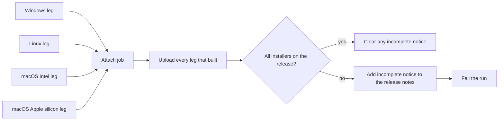
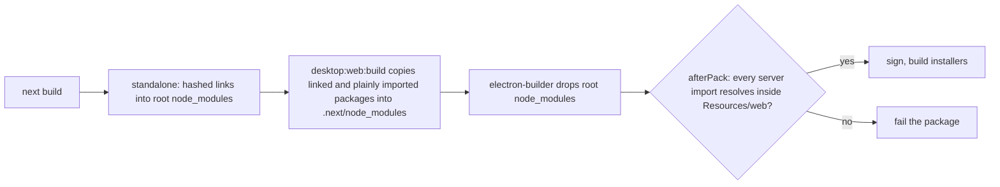

# Release process

SketchForge uses Conventional Commit pull request titles to drive releases.
The title is checked before merge because squash merging turns it into the
commit subject consumed by release-please. Use `feat:`, `fix:`, or another type
listed in `release-please-config.json`; a `!` or `BREAKING CHANGE:` footer marks
a breaking change.

## Version and release pull request

The root `package.json` version is the release authority. The engine, TypeScript
client, Python package, and `.release-please-manifest.json` must carry the same
version. Release Please reads `release-please-config.json` and opens or updates
a release pull request on `main`. It updates the publishing-client version table
in that pull request as part of its version bump. Review its version changes and
generated release notes, then merge that release pull request to publish the
release. If nobody does, `release-auto-merge.yml` merges it every four hours
once its checks have passed and `main` has been quiet for 30 minutes; the
`release: hold` label or the repository variable `RELEASE_AUTO_MERGE=false`
holds it. See [publishing the client libraries](PUBLISHING_CLIENTS.md) for the
full conditions.

Release Please authenticates as the repository's release GitHub App, using the
`APP_ID` and `APP_KEY` secrets, rather than with the default workflow token.
GitHub starts no workflow run for an event created by its own token, so with
the default token the release pull request carried no check results and had to
be approved by hand before any ran. The app is installed on this repository
alone and holds write access only to contents and pull requests.

Because the tag is pushed by that app, it would also start any workflow with a
tag trigger. `release.yml` and `desktop-release.yml` are dispatched by
`release-please.yml` and therefore declare no tag trigger; adding one back
would publish every release twice.

`docs/CHANGELOG.md` is maintained separately from the generated GitHub release
notes. Add user-visible changes there as part of their feature or fix pull
request.

## Pull request and performance checks

`ci.yml` runs typechecks and unit tests on code changes, including the Python
client unit suite, on both Linux and Windows. `trusted-pr-checks.yml` repeats
those checks for generated documentation pull requests and also runs browser,
API, integration, and documentation checks. `docs.yml` runs documentation
checks on every pull request. `ci.yml` skips code jobs only for pull requests
classified as documentation-only; pushes to `main` run them all.

The `Performance` workflow runs the performance suite on pushes to `main` and
weekly on Mondays. It uploads the complete test output as a 30-day artifact,
including when the suite fails, so regressions can be inspected alongside the
run.

## Publishing

After Release Please creates the tag and GitHub release, the release workflow
dispatches the Docker and Python publishing workflow and the desktop installers
workflow. Dispatch is the only path that starts them. The Python package uses PyPI trusted publishing; the Docker image is
published for the release version. Desktop installers require the signing and
notarization secrets described in [repository setup](../.github/SETUP.md).
Check all three workflow runs and the release assets before announcing a
release. A GitHub release can exist while an artifact workflow is still failing.

## Desktop installers

`desktop-release.yml` builds the installers on four runners and attaches them
to the release that Release Please already published. It does not re-run the
unit suite: CI ran it on Linux and Windows before the commit reached `main`.
Each build leg verifies its own packages before uploading them as an artifact.



The attach job runs even when a leg fails. It attaches every leg that built,
together with the `electron-updater` manifests: `latest.yml` for Windows,
`latest-linux.yml` for Linux, and `latest-mac.yml`, merged from both macOS
architectures, when macOS signing is configured. Unsigned macOS packages carry
an `-unsigned` suffix and no update manifest. If any installer is missing, the
job adds a warning naming the missing platforms to the top of the release notes
and fails the run. The rest of the notes are left as generated.

The Windows installer is currently unsigned because no Windows signing
certificate is configured. Releases include `SketchForge-Setup-<version>-x64.exe`
and `latest.yml`; users may see a SmartScreen warning. The README describes
how to verify and open the downloaded installer. Revisit the policy when a
Windows signing certificate is configured.

A failed leg is recovered by running the workflow again for the same version:

<!-- runnable-exempt: Dispatching this publishes release assets for a reader-supplied version; it is a maintainer recovery command, not a repository example. -->
```sh
gh workflow run desktop-release.yml --repo constructorfleet/SketchForge-3D -f version=X.Y.Z
```

The rerun builds the released tag, replaces only the assets of the platforms it
rebuilt, and keeps those of any platform that fails again. It removes the
warning once every installer is attached. It never marks an already published
release as latest. If the version has no release yet, the workflow creates a
draft and publishes it only once every installer is attached. Run the workflow
by hand only for recovery or an explicitly requested desktop rebuild. Normal
application releases start by merging the Release Please pull request.

### The packaged web bundle

Each installer carries the Next standalone server in `Resources/web`
(`resources/web` on Windows and Linux). The CAD kernels it loads, `occt-wasm`
and `manifold-3d`, are `serverExternalPackages`, which the server loads with
ES module imports. Those imports ignore the `NODE_PATH` the desktop main process
points at `app.asar/node_modules`, so the packages must be on disk inside
`Resources/web`. Two things keep them out:

- electron-builder never copies a root `node_modules` out of an
  `extraResources` source, so the standalone `node_modules` is dropped.
- Turbopack imports each external by a hashed name such as
  `occt-wasm-1b9e064a4904705b`, which `next build` writes as a symlink in
  `apps/web/.next/node_modules` into that dropped directory. The engine's own
  `import(/* webpackIgnore: true */ "occt-wasm")`, which STEP export, STEP
  import and assembly explode load the kernel through, keeps the plain name,
  which nothing in the bundle provides.

The 1.27.0 installers, built with webpack, shipped no links but had the same
problem: their chunks `import("occt-wasm")` and `import("manifold-3d")` with
neither package on disk.



`npm run desktop:web:build`, which `desktop:pack` and `desktop:dist` run first,
replaces each hashed link with a real copy of its package. It then copies in,
under its plain name, any package a server chunk still imports by that name.
The `afterPack` hook in `apps/desktop/electron-builder.yml`
(`apps/desktop/afterPack.cjs`) checks the result on every platform, including
a local `--dir` build. It runs before signing, so a bundle that cannot load the
CAD kernels never becomes a release asset. It fails the package when:

- `Resources/web` has a dangling link, or a server external that is a link;
- a module the compiled server imports (Turbopack's `.y("…")` or a plain
  `import("…")`) does not resolve on disk inside `Resources/web` (resolution
  never looks above it, so a build packaged inside a checkout cannot pass on
  the repository's own `node_modules`);
- a module it requires through Turbopack's `.x("…")` is not a Node builtin,
  not on disk, and not one of the packages Next's runtime takes from
  `app.asar` through `NODE_PATH` (`next`, `react`, `react-dom`, `styled-jsx`).

A plain `require("…")` is not checked: Next's runtime uses that form for
optional, guarded requires, and CommonJS resolves through `NODE_PATH`.
`tests/unit/desktopWebBundle.test.ts` covers both steps, including a bundle
shaped like 1.27.0 that must fail.
