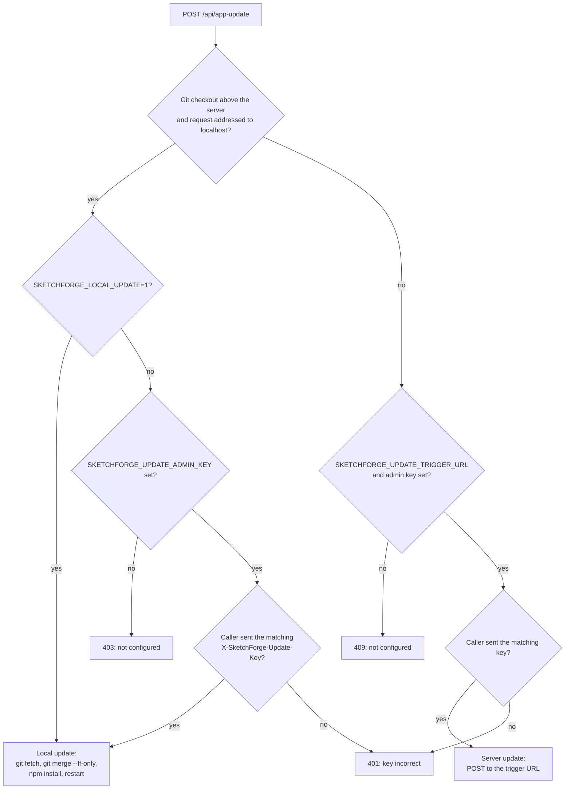

# Deployment configuration

This guide covers the server and container settings operators can configure. For a complete list of supported values, defaults, sensitivity, source readers, and owning pages, see the [operator configuration reference](../OPERATOR_CONFIGURATION.md). The [Docker / FabLab Server instructions](https://github.com/constructorfleet/SketchForge-3D#docker-fablab-server-recommended) cover initial setup and compose commands.

## GitHub Pages browser demo

The documentation workflow also builds a static editor demo and publishes it at [`/Demo/`](https://constructorfleet.github.io/SketchForge-3D/Demo/). Its Next.js base path is set at build time to `/<repository>/Demo`, and the workflow stages the export alongside the documentation site. The editor stores each visitor's projects in that visitor's browser. Static hosting does not provide server-side project storage or the REST API; use a server deployment for those features.

## Docker listener

The compose files publish container port `3000` on host port `3000` by default. Set `SKETCHFORGE_PORT` to change the host port. Inside the container, `PORT` selects the Next.js listener port, `HOSTNAME` selects its bind address, and `SKETCHFORGE_LEGACY_PORT` selects the compatibility proxy port (`80` by default). The launcher accepts ports from 1 through 65535 and falls back to its documented default for invalid values. Set the legacy port equal to `PORT` to disable the compatibility proxy. See the [port configuration example](https://github.com/constructorfleet/SketchForge-3D#use-a-different-port).

## Server-backed projects

Set `SKETCHFORGE_PROJECTS_DIR` to a writable persistent directory to store a user's projects on the server instead of in browser-local storage. The Docker compose configuration maps `/data/my-projects` to the `sketchforge-projects` volume by default; `SKETCHFORGE_PROJECTS_VOLUME` changes that volume or bind-mount source. See [server-side project storage](https://github.com/constructorfleet/SketchForge-3D#server-side-project-storage) for migration and persistence behavior.

## REST API access

Set `SKETCHFORGE_API_TOKEN` together with `SKETCHFORGE_PROJECTS_DIR` to enable authenticated REST API access. Treat the token as a secret: use a high-entropy value, store it in the deployment's secret manager, and keep it out of browser code and logs. See the [REST API deployment instructions](https://github.com/constructorfleet/SketchForge-3D#rest-api).

## Shared projects

The Docker image stores shared projects at `/data/projects` by default. Set `SKETCHFORGE_SHARED_PROJECTS_DIR` to change the path, and mount persistent storage there. The default compose volume is `sketchforge-shared-projects`; set `SKETCHFORGE_SHARED_PROJECTS_VOLUME` to choose another named volume or bind-mount source. See [shared Docker projects](https://github.com/constructorfleet/SketchForge-3D#shared-docker-projects).

## Volume ownership

The server runs as the `node` user, UID `1000`, so every directory it saves into must be writable by that user. Docker creates the mount point of a fresh named or anonymous volume owned by `root` whenever the path does not already exist in the image, and the storage directories are whatever `SKETCHFORGE_SHARED_PROJECTS_DIR` and `SKETCHFORGE_PROJECTS_DIR` name, so the image cannot prepare them ahead of time. Instead the container starts as `root` in a small entrypoint that creates both configured directories, hands each one to `node`, and then drops privileges before the server starts. Named volumes at the documented paths, at paths of your own, and volumes left `root`-owned by images up to 1.23.0 all work without setup.

The entrypoint changes the owner of the directory itself, not of the files below it. The server wrote those files as `node`, so they already belong to it.

**Bind mounts.** A bind-mounted host directory is handed to UID `1000` the same way, which changes that directory's owner on the host. Create it first if you want to choose where it lives:

<!-- runnable-exempt: This host-side setup uses an operator-chosen bind-mount path on the Docker host. -->
```bash
mkdir -p /srv/sketchforge/my-projects
SKETCHFORGE_PROJECTS_DIR=/data/my-projects \
SKETCHFORGE_PROJECTS_VOLUME=/srv/sketchforge/my-projects \
  docker compose -f deploy/docker/compose-ghcr.yaml up -d
```

**Running without root.** With `docker run --user 1000:1000`, rootless Docker, or a platform that refuses root containers, the entrypoint cannot change ownership. It still creates what it can, starts the server as that user, and logs a line naming any configured directory that user cannot write, so a misconfigured mount shows up in `docker logs` rather than on the first save. Make the mounted directory writable by that UID yourself in this mode.

The container health check asks `/api/shared-projects` for its status. Turning shared projects off with an empty `SKETCHFORGE_SHARED_PROJECTS_DIR` leaves the container healthy; an unreadable shared library reports it unhealthy.

## Application updates

The dashboard checks the official release manifest and offers an update when a newer version exists. The **Update** button calls `POST /api/app-update`, which works in one of two modes. Each mode has its own gate.



**Server mode** is for container and managed deployments. Set `SKETCHFORGE_UPDATE_TRIGGER_URL` to an internal endpoint you control that recreates only the SketchForge application and keeps its project volumes. Also set `SKETCHFORGE_UPDATE_ADMIN_KEY`, the key the administrator types into the update dialog. `SKETCHFORGE_UPDATE_TRIGGER_TOKEN` is optional; SketchForge sends it as a bearer token to the trigger endpoint. The Docker image contains no `.git` directory, so a container always uses server mode.

**Local mode** applies when the server runs from a git clone and the request is addressed to `localhost`, `127.0.0.1`, or `[::1]`. It runs `git fetch` and `git merge --ff-only` against the official repository and `npm install` in that checkout, then restarts the dev server. It needs one of the following:

- `SKETCHFORGE_UPDATE_ADMIN_KEY`: the dialog asks for the key, as in server mode.
- `SKETCHFORGE_LOCAL_UPDATE=1`: no key is asked for. Set this only when the server listens on loopback alone, for example `npx next dev apps/web -H 127.0.0.1`.

With neither set, the dialog links to the update guide and the endpoint returns 403.

The address check uses the Host header, which the client controls. A route handler cannot see the TCP peer address: Next.js keeps a client-supplied `X-Forwarded-For` header and does not replace it. Any machine that can reach the server can therefore claim to be `localhost`. Treat the admin key or the loopback-only listener as the security boundary.

Releases up to 1.23.0 ran local mode with neither setting. If you update a source checkout from the dashboard, set one of them.

The packaged desktop app does not use this endpoint. It updates through its built-in release updater, and none of these settings affect it.
