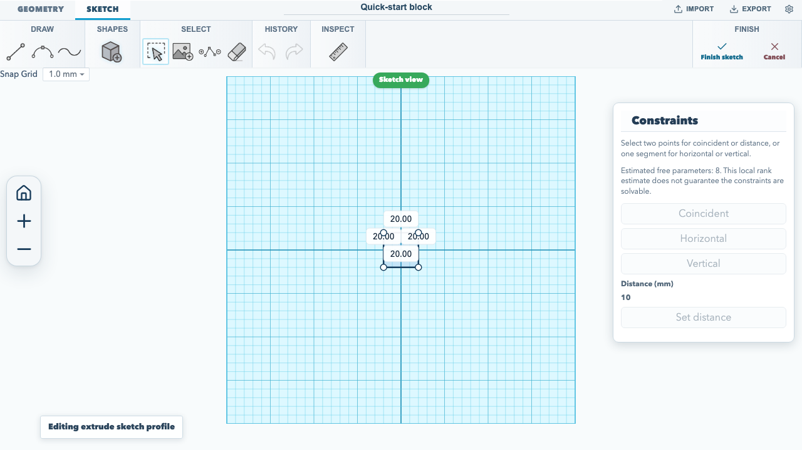
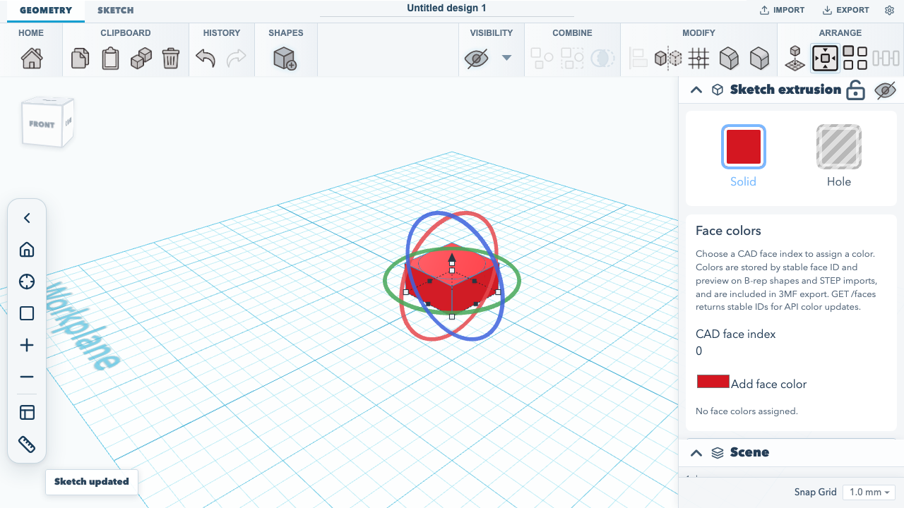
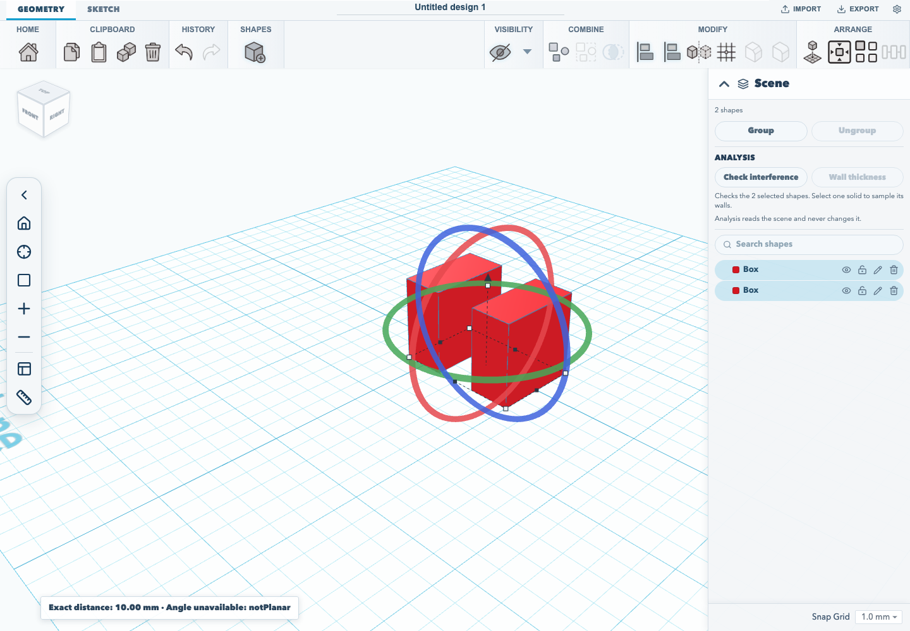
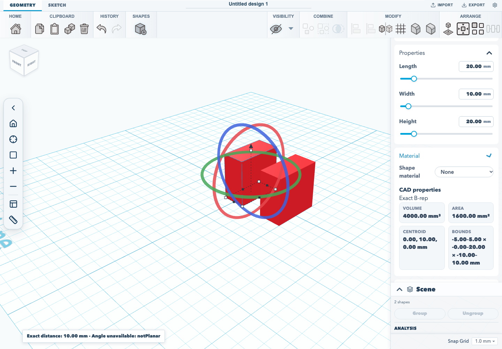
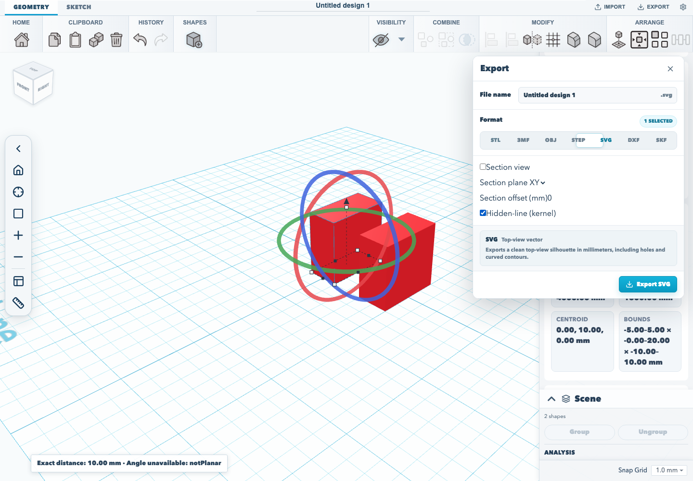
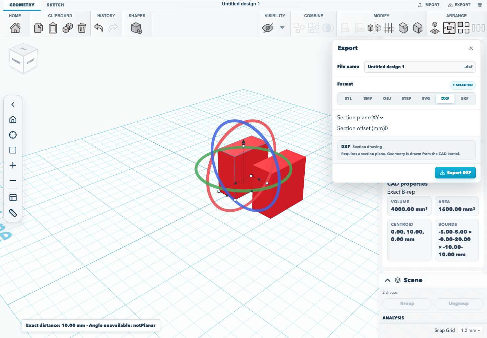

# Create, edit, save, and export a model

This workflow makes a block, adds a circular feature through sketch editing, confirms the project survives a reload, and exports an editable `.skf` project. It uses the editor's visible controls and default 10 mm extrusion height.

## 1. Create a project and the first solid

From the dashboard, choose **Create new 3D design**. In the editor, choose **Sketch**, then **Sketch to 3D** and **Extrude sketch**. Choose **Add sketch shape** and **Rectangle**, then **Finish sketch**. The rectangle becomes a solid named **Sketch extrusion**.

For the first model from a rectangle, see the [editor quick start](./editor-quickstart.md).

## 2. Edit the sketch to add a circular feature

Select **Sketch extrusion** in the scene list and choose **Edit sketch** in the inspector. In sketch mode, choose **Add sketch shape**, then **Circle**. The circle is centered on the sketch origin, inside the rectangle. It adds a second closed profile to the sketch. Choose **Finish sketch**. The editor rebuilds the existing solid from the updated profile and reports **Sketch updated**.



The editor retains the sketch profile as part of the extrusion. For a guided first sketch and an overview of the editor controls, see the [editor quick start](./editor-quickstart.md).

## 3. Save and confirm the edit

Rename the project in the field at the top of the editor and press **Enter**. Project changes save automatically in this browser. Reload the editor page while the project is open; confirm that **Sketch extrusion** and the project name remain. Browser storage is local to this browser profile.



## 4. Export a portable editable project

Choose **Export**, select **SKF: Editable project**, then choose **Save SketchForge Project**. The browser downloads a `.skf` file that preserves the editable sketch and project data. See the [project format guide](../SKF_PROJECT_FORMAT.md) for more about what `.skf` stores and the [editor quick start](./editor-quickstart.md) for other available mesh and CAD export formats.


## 5. Measure geometry and export a technical drawing

Select two shapes in the scene list, then choose **Measure selected shapes**. The measurement panel can compare the whole shapes or a face or edge index on each one. It reports exact minimum distance and, for two planar faces, their angle. An unavailable angle includes the kernel's reason. The inspector shows volume, area, centroid and bounds; imported meshes are labeled tessellated.

Choose **Export**, then select **DXF** and set the section plane and offset to export a kernel section drawing. For SVG, enable **Hidden-line (kernel)** for an exact projected drawing, or enable **Section view** for a section SVG. DXF always requires a section plane.



The inspector distinguishes exact B-rep values from measurements derived from an imported mesh.







## Verified workflow

The browser acceptance test performs these steps: it creates the rectangular extrusion, opens **Edit sketch**, adds the circle, finishes the edit, renames and reloads the project, reopens the sketch to confirm the added segments persisted, then downloads the `.skf` file. Run it with:

<!-- runnable-exempt: This command runs the browser acceptance workflow; its maintained implementation is tests/browser/editor-quickstart.test.mjs, not a standalone script block. -->
```sh
npm run test:browser
```
