# Make and export your first model

This walkthrough creates a block from a rectangle, confirms that the project reopens with its model, and downloads an editable SketchForge project. It uses the editor's visible controls and the default sketch extrusion settings.

For a follow-on task that edits the extrusion sketch before saving and exporting, see [create, edit, save, and export a model](./edit-and-export-model.md).
To constrain sketch geometry while editing, see [constrain sketch geometry](./sketch-constraints.md).

## 1. Create a project

From the dashboard, choose **Create new 3D design**. SketchForge opens a blank project in the editor.

## 2. Start an extrusion sketch

Choose the **Sketch** tab. In the Sketch toolbar, choose **Sketch to 3D**, then **Extrude sketch**. This starts a sketch on the selected workplane.

## 3. Add a closed profile

Choose **Add sketch shape**, then **Rectangle**. The rectangle is placed at the sketch origin. The shape menu also offers Circle, Triangle, and Hexagon. A closed profile is required for an extrusion.

Choose **Finish sketch** to create the solid. SketchForge builds the extrusion at its default height of 10 mm. The resulting shape appears in the scene list as **Sketch extrusion**.

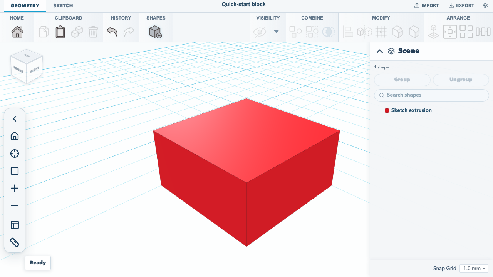

## 4. Rename and confirm the project is saved

Edit the project name field at the top of the editor and press **Enter**. The editor saves project changes in this browser automatically. Reload the page while the project is open; the project name and extrusion should still be present.

Browser storage is local to this browser profile. To keep a portable project file, export the project in the next step.

## 5. Export an editable project

Choose **Export**. In the export dialog, select **SKF: Editable project**, then choose **Save SketchForge Project**. The browser downloads a `.skf` file named after the project. An SKF file preserves the editable project, including sketches and project data.

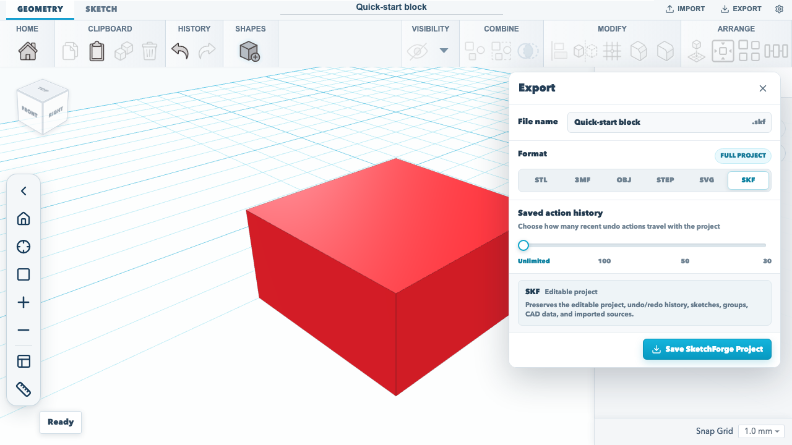

The same dialog can export mesh or CAD formats such as STL, 3MF, OBJ, and STEP. Choose STL or 3MF for a 3D-printing workflow; keep the `.skf` file when you want to reopen and continue editing the project.

## Back up every project at once

Projects saved in the browser live in that browser profile's storage. The first time the dashboard is shown, SketchForge asks the browser to keep that storage persistent. It asks once per profile. Without persistence the browser may clear it when the device runs low on space. Some browsers grant the request silently, some ask you, and some decline it.

To check, open **Workspace settings** in the editor and choose **Storage**. The section shows whether persistent storage is on and how much of the browser's allowance is in use. When persistence is off, **Ask the browser to keep projects** asks again. Some browsers grant persistence only when you ask with a click. When projects are stored in a server directory, the section says so instead, because clearing the browser does not remove them. SketchForge does not ask for persistent storage in that mode.

On the dashboard, choose **Export all projects**. The browser downloads one ZIP named `sketchforge-projects-YYYY-MM-DD.zip`, holding a `.skf` file for each project. It includes all your projects, even those a search is hiding, and keeps the undo history autosave keeps. When another tab has saved a newer version of a project, the export uses that version. Entries named after a Windows device such as `CON` start with `_`, and leading dots are dropped, so the archive extracts on any system. Dashboard thumbnails are left out because SketchForge creates them again from the model. When **Settings** saves downloads to a folder, the ZIP goes there instead.

When the browser has used 80 percent or more of its allowance, the dashboard shows a warning with its own **Export all projects** button. To restore a project, unzip the archive and open its `.skf` file with **Open SKF or import geometry**. Open one `.skf` file at a time.

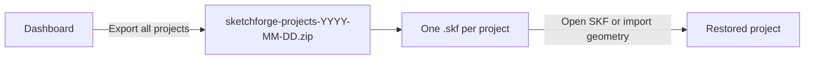

## When a project cannot be read

Sometimes SketchForge cannot open a project's stored copy. The `.skf` package may be damaged or come from a newer release, or the browser storage or server that holds it may be unavailable. In either case the editor stays closed, the dashboard names the project and shows the error, and the stored copy is left untouched. Autosave does not write to the project until it loads again or you start it over. This applies to projects in the browser, in a server directory, and in the desktop app.

In browser storage, another tab may save a newer copy that this tab cannot read. When that happens, this tab closes its editor instead of saving its older copy over the newer one.

### When another client changed the project

Several browsers, or the desktop app, can share one server project directory. Each save says which revision of the project it started from, and the server refuses a save when another client has saved a newer revision since. The editor then closes and the dashboard says the project was changed elsewhere:

- **Open the newer copy** loads what the other client saved. Changes this client made since it opened the project are not kept.
- **Download my copy** saves this client's unsaved copy, with every edit made before the save was refused, as `<name> (my copy).skf`. You can compare the two, or open it as a separate project.

The message stays until you open the newer copy, so the unsaved copy can always be downloaded first.

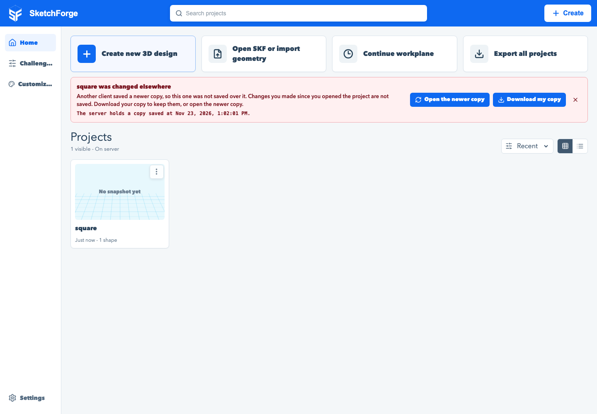

When a browser window comes back into view, it checks the server for newer copies and loads them, so you usually see the other client's work before you edit. REST API writes count as saves from another client.

A project's name and settings are merged instead. When two clients change them at once, each keeps the fields it changed. A rename in one browser is not undone by another browser that still shows the old name, and it appears there when that window comes back into view.

### When another client deleted the project

A delete on the server wins over every later save. When another client deletes a project that this client still has open, the server refuses this client's next save, the editor closes, and the dashboard says the project was deleted elsewhere:

- **Download my copy** saves this client's unsaved copy as `<name> (my copy).skf`.
- **Save as a new project** saves that copy to the server under a new ID, and the deleted project leaves this list.

Closing the message removes the deleted project from this list without saving the copy.

The same message appears when a browser moves its projects to server storage and the server has already deleted one of them, if this browser holds edits to it that never reached the server. A copy with no such edits is simply dropped.

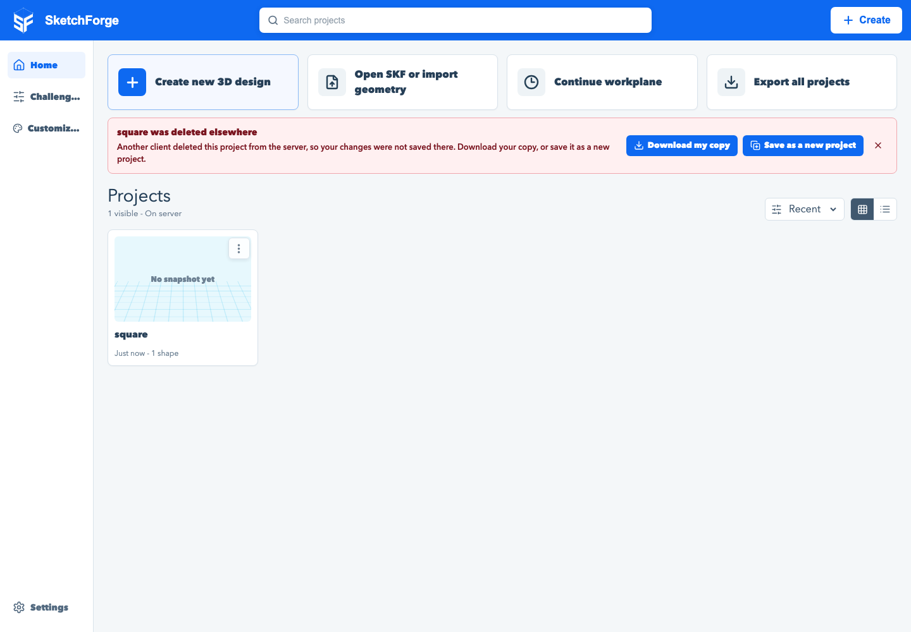

### When the server has no package for a project

If the server holds a project's details but not its `.skf` package, or the package is a symlink or another file that is not a regular file, the project does not open as an empty project. The dashboard says the project has no stored package and offers **Try again** and **Start over**. **Start over** replaces the missing package, or the symlink itself, with an empty project; it does not write through a symlink. If another client saves the project after this one read it, **Start over** is refused, and **Try again** opens that client's copy.

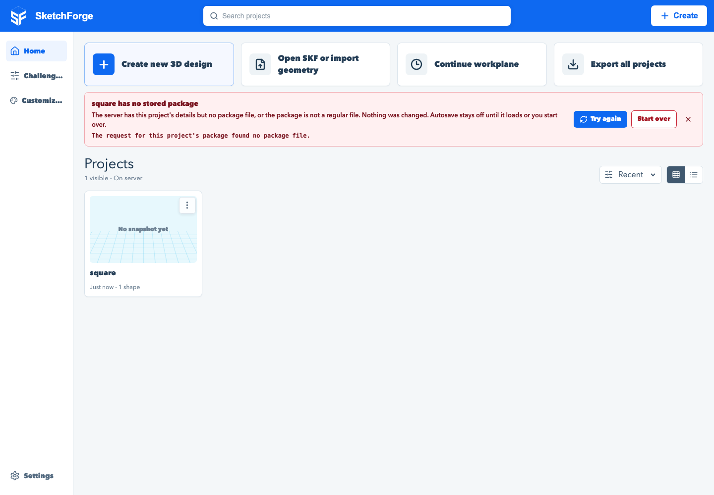

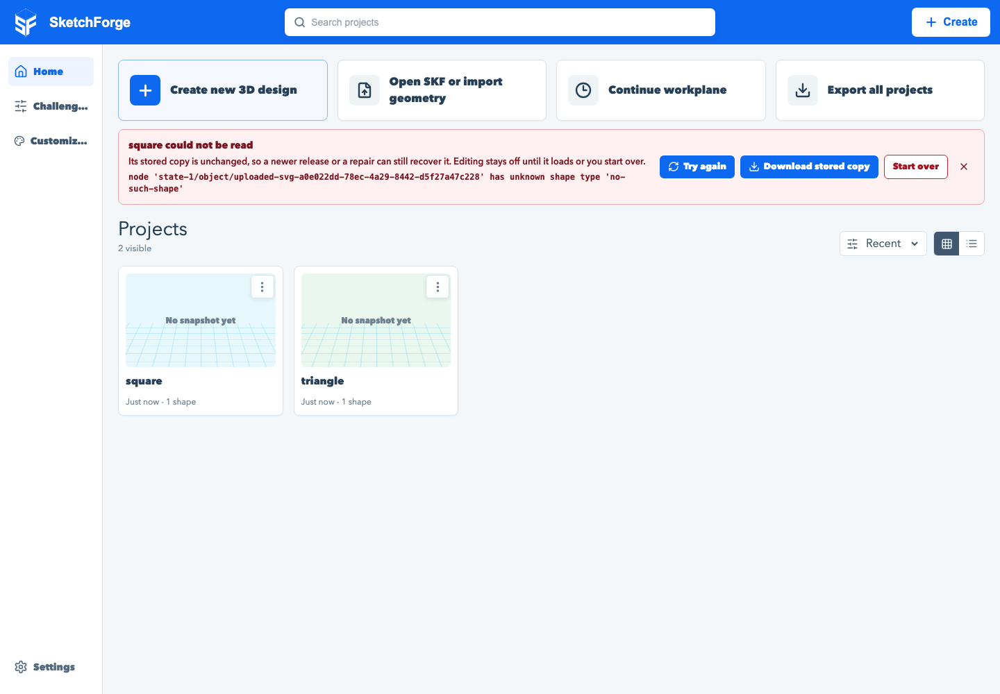

When the stored copy was read but could not be opened:

- **Try again** reads the stored copy again.
- **Download stored copy** saves the stored `.skf` exactly as it is, so you can repair it or open it in a newer release. A project saved before SketchForge stored `.skf` packages in the browser downloads as a `.json` file with whatever data is left; binary data in it is base64.
- **Start over** replaces the stored copy with an empty project. It asks you to confirm first, because the old copy cannot be recovered after that.

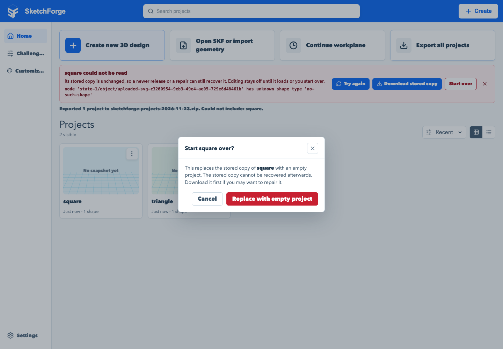

When the storage or server could not be reached, the dashboard says the project could not be loaded and offers only **Try again**, because nothing was read that could be downloaded or replaced. The detail names the failed request for the project package: the HTTP status, a request that never reached the server, or an answer that was not a project package, such as a proxy's sign-in page. A browser storage error that a retry cannot fix, such as a value that cannot be decoded, counts as a copy that cannot be read, so **Start over** is offered.

If a newer SketchForge release has upgraded this browser's project storage, an older release cannot open any of it. The dashboard says so and offers no actions, because none of them could work. Open the project in the newer release.

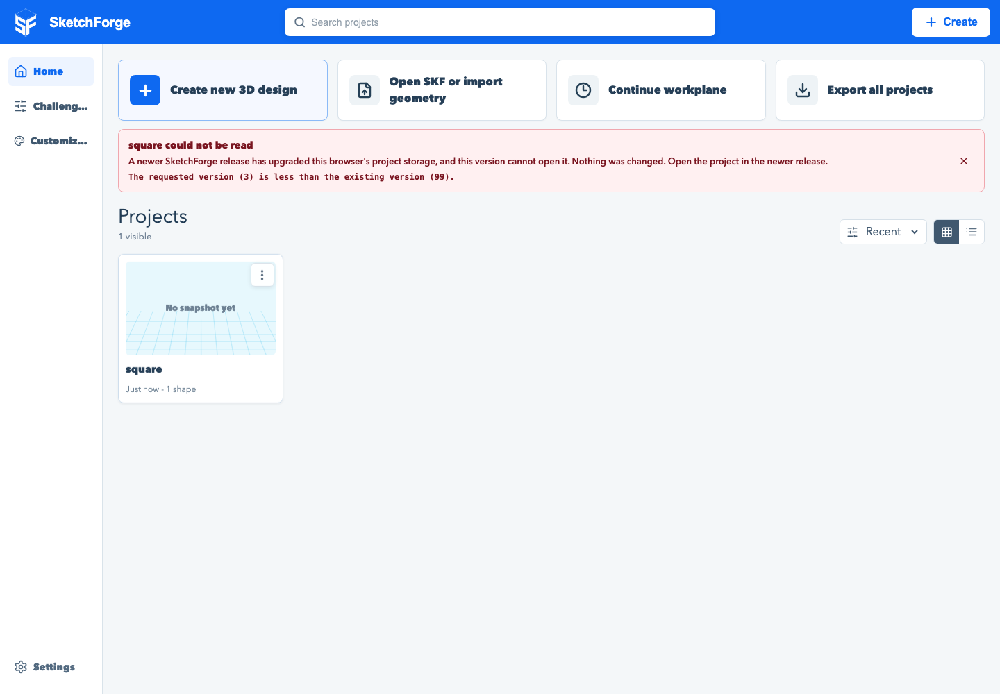

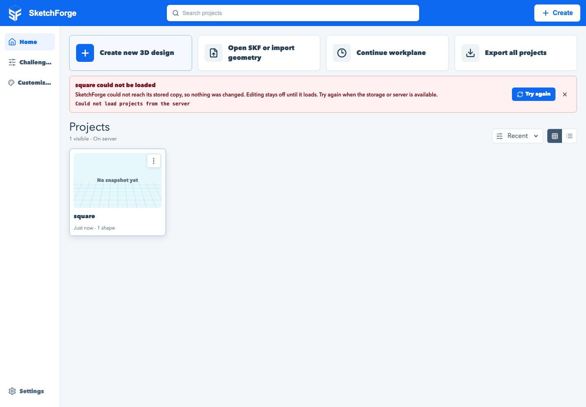

**Export all projects** leaves out a project it cannot read and names it in the result.

## Keyboard shortcuts

Press **?** in the editor to open the keyboard-shortcuts list. Press **Escape** to close it. The list includes the common edit shortcuts; selection visibility and locking use bindings that do not collide with macOS or browser-reserved keys:

- **Shift+L** locks or unlocks the selection.
- **Shift+H** hides or shows the selection.
- **Alt+Shift+H** shows all hidden shapes.

The `?` key may require **Shift+/** on keyboards where `?` shares the slash key.

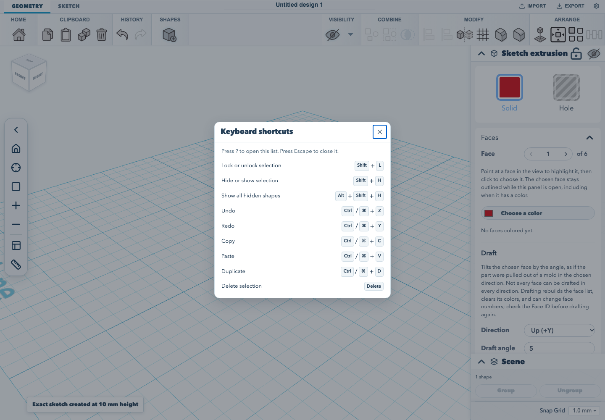

A locked shape cannot have its sketch reopened. **Edit Sketch to 3D** on the toolbar and **Edit sketch** in the inspector are both unavailable for it. A sketch whose shape is locked while it is open, for example from the Geometry tab, cannot be finished; cancel it instead. A shape that holds a locked part, such as a group from an imported project, cannot be filleted, chamfered, hollowed or face-drafted, because each of these rewrites that part; its face colours stay editable. **Separate Parts** still splits a plain group, keeping each part's lock, as **Ungroup** does. The edge feature history leaves locked parts, and a group that holds one, as they are. The REST and MCP `treat` operation is less strict: it fillets a cut whose operand is locked, because it leaves the operand unchanged.

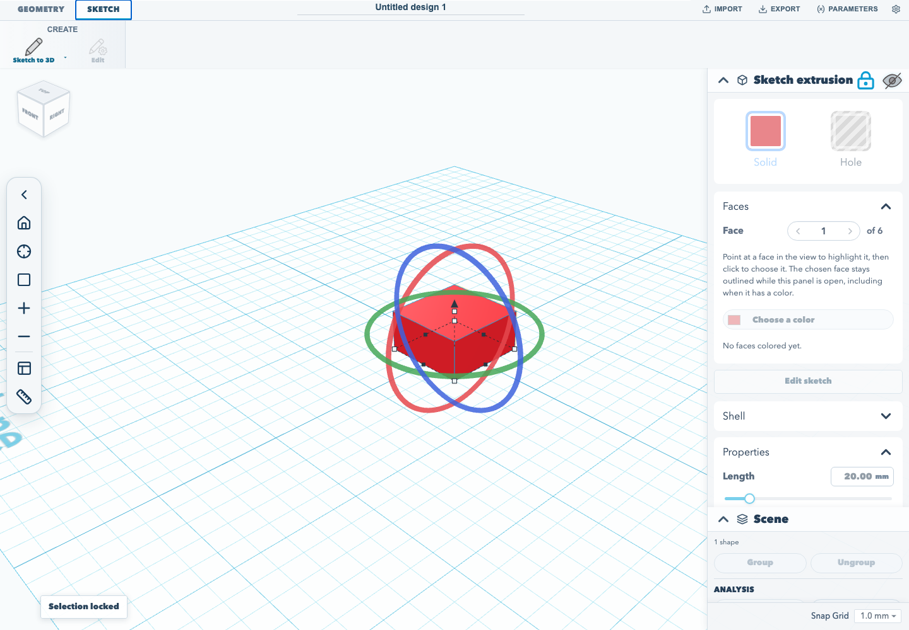

## Verified workflow

The browser acceptance test starts from an empty dashboard, creates a project, adds the rectangle through the sketch toolbar, finishes the extrusion, renames and reloads the project, then downloads the `.skf` file. Run it with:

<!-- runnable-exempt: This command runs the browser acceptance workflow; its maintained implementation is tests/browser/editor-quickstart.test.mjs, not a standalone script block. -->
```sh
npm run test:browser
```
