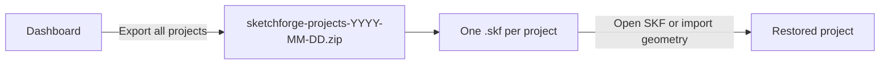
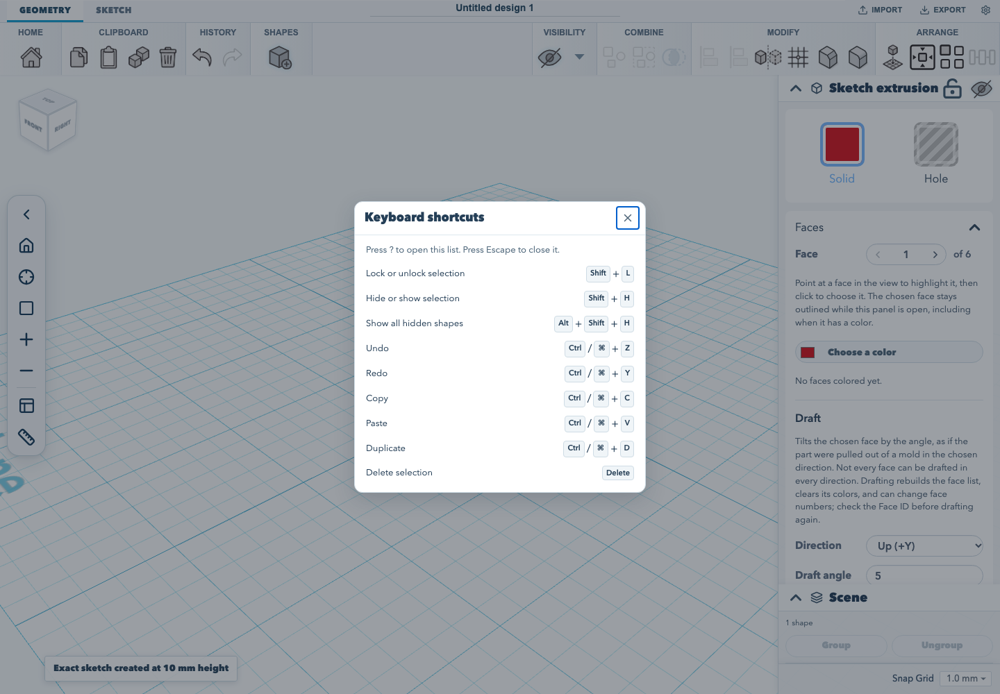

# Make and export your first model

This walkthrough creates a block from a rectangle, confirms that the project reopens with its model, and downloads an editable SketchForge project. It uses the editor's visible controls and the default sketch extrusion settings.

For a follow-on task that edits the extrusion sketch before saving and exporting, see [create, edit, save, and export a model](./edit-and-export-model.md).
To constrain sketch geometry while editing, see [constrain sketch geometry](./sketch-constraints.md).

## 1. Create a project

From the dashboard, choose **Create new 3D design**. SketchForge opens a blank project in the editor.

## 2. Start an extrusion sketch

Choose the **Sketch** tab. In the Sketch toolbar, choose **Sketch to 3D**, then **Extrude sketch**. This starts a sketch on the selected workplane.

## 3. Add a closed profile

Choose **Add sketch shape**, then **Rectangle**. The rectangle is placed at the sketch origin. The shape menu also offers Circle, Triangle, and Hexagon. A closed profile is required for an extrusion.

Choose **Finish sketch** to create the solid. SketchForge builds the extrusion at its default height of 10 mm. The resulting shape appears in the scene list as **Sketch extrusion**.


## 4. Rename and confirm the project is saved

Edit the project name field at the top of the editor and press **Enter**. The editor saves project changes in this browser automatically. Reload the page while the project is open; the project name and extrusion should still be present.

Browser storage is local to this browser profile. To keep a portable project file, export the project in the next step.

## 5. Export an editable project

Choose **Export**. In the export dialog, select **SKF: Editable project**, then choose **Save SketchForge Project**. The browser downloads a `.skf` file named after the project. An SKF file preserves the editable project, including sketches and project data.


The same dialog can export mesh or CAD formats such as STL, 3MF, OBJ, and STEP. Choose STL or 3MF for a 3D-printing workflow; keep the `.skf` file when you want to reopen and continue editing the project.

## Back up every project at once

Projects saved in the browser live in that browser profile's storage. The first time the dashboard is shown, SketchForge asks the browser to keep that storage persistent. It asks once per profile. Without persistence the browser may clear it when the device runs low on space. Some browsers grant the request silently, some ask you, and some decline it.

To check, open **Workspace settings** in the editor and choose **Storage**. The section shows whether persistent storage is on and how much of the browser's allowance is in use. When persistence is off, **Ask the browser to keep projects** asks again. Some browsers grant persistence only when you ask with a click. When projects are stored in a server directory, the section says so instead, because clearing the browser does not remove them. SketchForge does not ask for persistent storage in that mode.

On the dashboard, choose **Export all projects**. The browser downloads one ZIP named `sketchforge-projects-YYYY-MM-DD.zip`, holding a `.skf` file for each project. It includes all your projects, even those a search is hiding, and keeps the undo history autosave keeps. When another tab has saved a newer version of a project, the export uses that version. Entries named after a Windows device such as `CON` start with `_`, and leading dots are dropped, so the archive extracts on any system. Dashboard thumbnails are left out because SketchForge creates them again from the model. When **Settings** saves downloads to a folder, the ZIP goes there instead.

When the browser has used 80 percent or more of its allowance, the dashboard shows a warning with its own **Export all projects** button. To restore a project, unzip the archive and open its `.skf` file with **Open SKF or import geometry**. Open one `.skf` file at a time.



## Keyboard shortcuts

Press **?** in the editor to open the keyboard-shortcuts list. Press **Escape** to close it. The list includes the common edit shortcuts; selection visibility and locking use bindings that do not collide with macOS or browser-reserved keys:

- **Shift+L** locks or unlocks the selection.
- **Shift+H** hides or shows the selection.
- **Alt+Shift+H** shows all hidden shapes.

The `?` key may require **Shift+/** on keyboards where `?` shares the slash key.



## Verified workflow

The browser acceptance test starts from an empty dashboard, creates a project, adds the rectangle through the sketch toolbar, finishes the extrusion, renames and reloads the project, then downloads the `.skf` file. Run it with:

<!-- runnable-exempt: This command runs the browser acceptance workflow; its maintained implementation is tests/browser/editor-quickstart.test.mjs, not a standalone script block. -->
```sh
npm run test:browser
```
