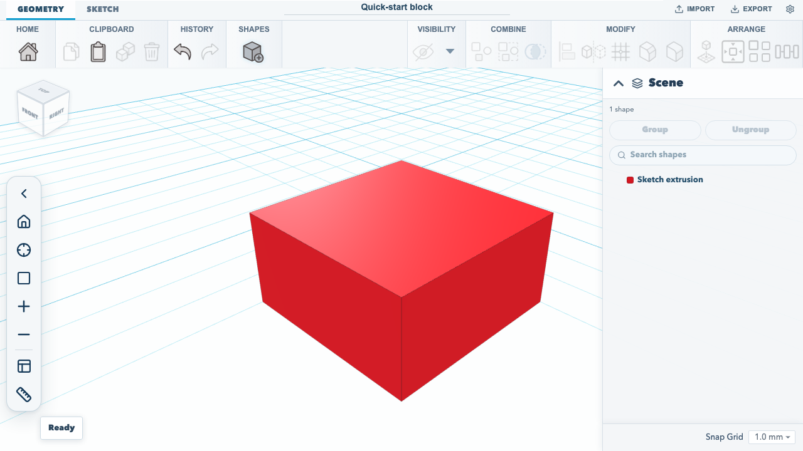
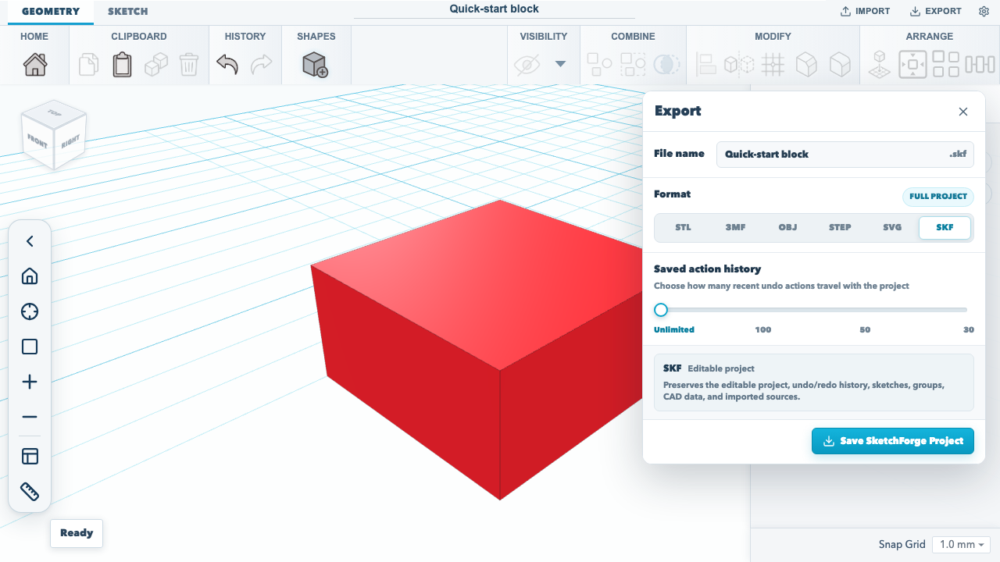

# Make and export your first model

This walkthrough creates a block from a rectangle, confirms that the project reopens with its model, and downloads an editable SketchForge project. It uses the editor's visible controls and the default sketch extrusion settings.

For a follow-on task that edits the extrusion sketch before saving and exporting, see [create, edit, save, and export a model](./edit-and-export-model.md).

## 1. Create a project

From the dashboard, choose **Create new 3D design**. SketchForge opens a blank project in the editor.

## 2. Start an extrusion sketch

Choose the **Sketch** tab. In the Sketch toolbar, choose **Sketch to 3D**, then **Extrude sketch**. This starts a sketch on the selected workplane.

## 3. Add a closed profile

Choose **Add sketch shape**, then **Rectangle**. The rectangle is placed at the sketch origin. The shape menu also offers Circle, Triangle, and Hexagon. A closed profile is required for an extrusion.

Choose **Finish sketch** to create the solid. SketchForge builds the extrusion at its default height of 10 mm. The resulting shape appears in the scene list as **Sketch extrusion**.



## 4. Rename and confirm the project is saved

Edit the project name field at the top of the editor and press **Enter**. The editor saves project changes in this browser automatically. Reload the page while the project is open; the project name and extrusion should still be present.

Browser storage is local to this browser profile. To keep a portable project file, export the project in the next step.

## 5. Export an editable project

Choose **Export**. In the export dialog, select **SKF: Editable project**, then choose **Save SketchForge Project**. The browser downloads a `.skf` file named after the project. An SKF file preserves the editable project, including sketches and project data.



The same dialog can export mesh or CAD formats such as STL, 3MF, OBJ, and STEP. Choose STL or 3MF for a 3D-printing workflow; keep the `.skf` file when you want to reopen and continue editing the project.

## Verified workflow

The browser acceptance test starts from an empty dashboard, creates a project, adds the rectangle through the sketch toolbar, finishes the extrusion, renames and reloads the project, then downloads the `.skf` file. Run it with:

```sh
npm run test:browser
```
