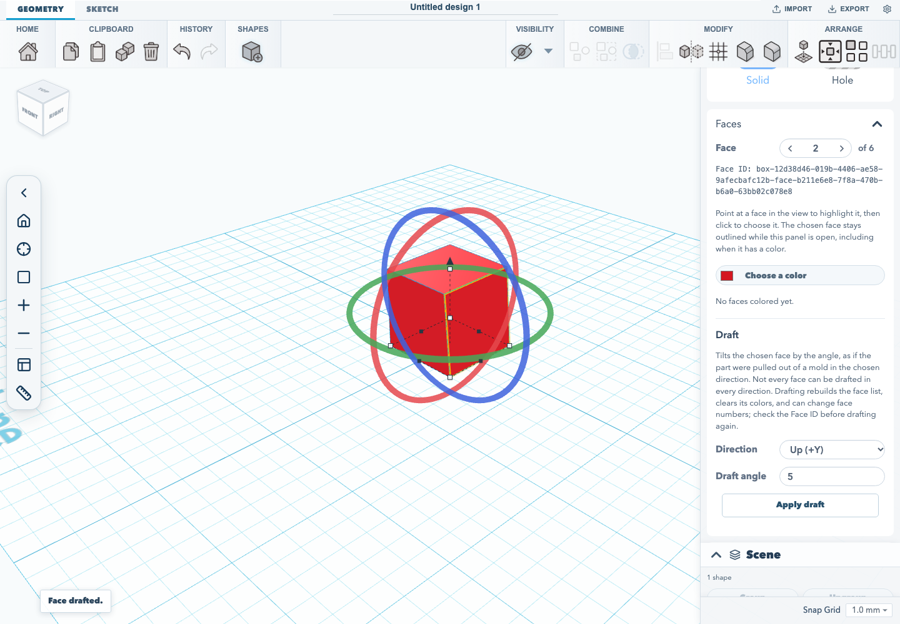
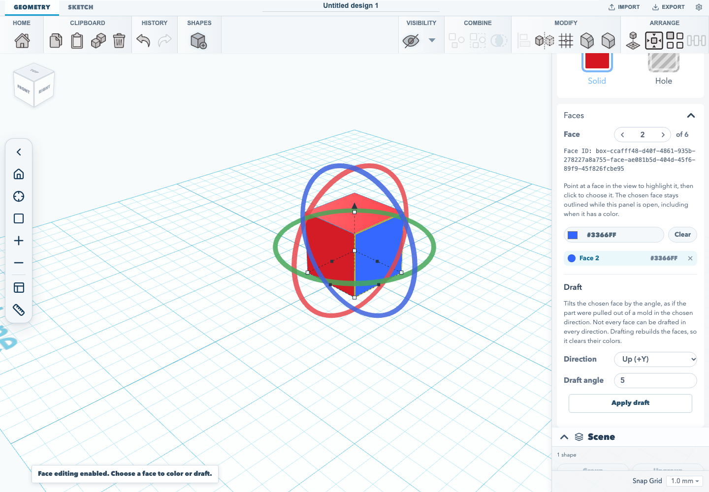
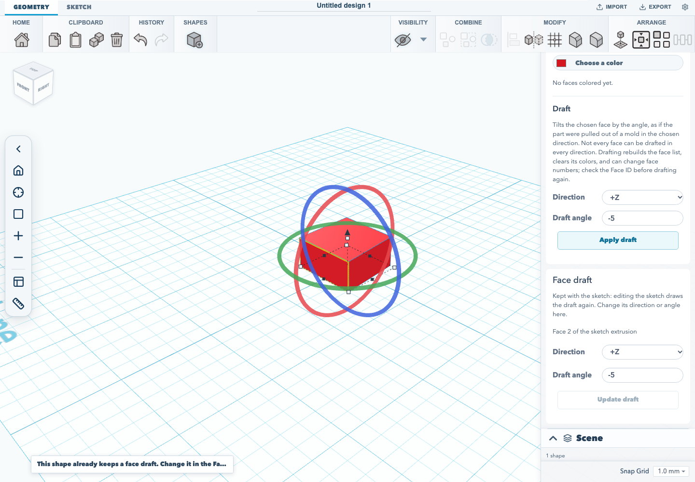
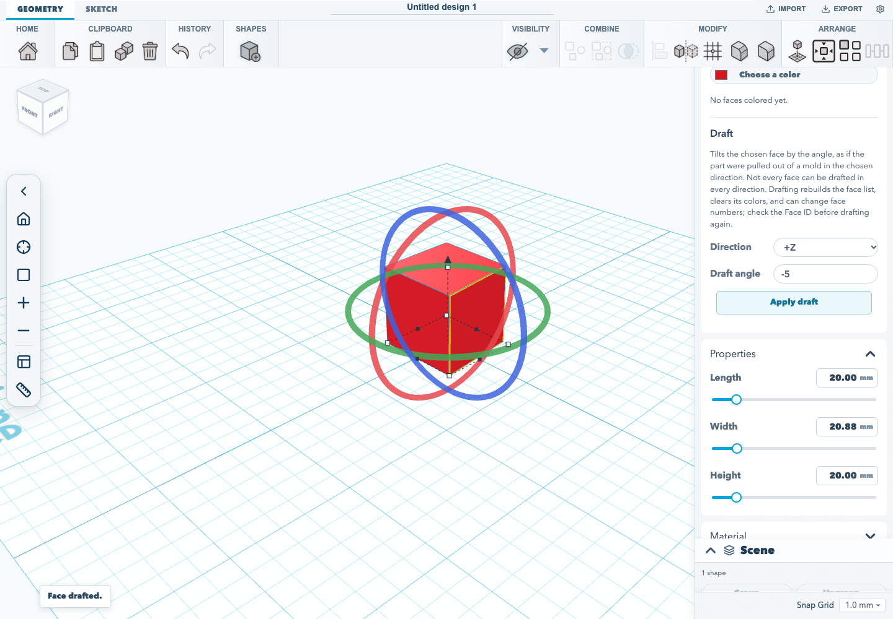
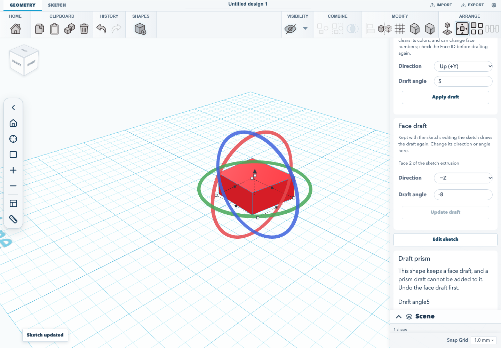

# Face drafting

Face colours and face drafts live in the **Faces** panel of the shape
inspector. Both act on one face at a time.

## Choose a face

While the selected shape's **Faces** panel is open, point at the shape in the
view: the face under the pointer is highlighted. Clicking a face in the view
chooses it, and the **Face** stepper jumps to it. A click chooses a face only
when neither the pointer nor the shape moves; pressing on the shape and
dragging still moves it as usual, and a press that nudges it across a snap step
moves it without changing the chosen face. Shift-click still adds to the
selection, a shape in front still takes the click, and the transform handles
and the empty grid behave as they always have. Picking is off while the panel
is collapsed, while the shape is locked, and in the workplane, ruler,
edge-modifier and align modes; turning one of those on, or moving the camera,
takes the hover highlight away until the pointer moves over a face again.

The **Face** stepper is the keyboard way to choose a face: type a number or use
the previous and next buttons. Faces are numbered from 1, and the panel shows
how many the shape has. While the pointer is over the panel, the chosen face
is highlighted in the view, or shown in its own colour if it has one. When
the shape's faces have stable IDs, as they do once face editing is enabled or
a face is drafted, the panel shows the chosen face's **Face ID**. It is the ID
face colours are stored under, and the one `GET /faces` lists for that face
once the project is saved on the server, where faces count from 0, so face 1 in
the panel is index 0 there.

Picking and highlighting change only what the view shows and which face the
panel acts on. Nothing is saved and no undo step is recorded until a colour or
draft is applied.

## Enable face editing

A solid built from a shape's own parameters, such as a box, cylinder, cone,
sphere or torus, has no exact faces yet. Its **Faces** panel offers
**Enable face editing**, which rebuilds the shape in place as exact solid
geometry, the same kind a fillet or chamfer produces. Its size stays editable,
but settings that belong to the shape type, such as the number of sides, become
fixed. The step is undoable. Sketch extrusions, sweeps, filleted or chamfered
shapes and STEP imports already have exact faces, so the panel opens on the
face tools directly. Holes, text, groups, imported pictures and plain meshes
do not offer it. A shape turned any way, including one tilted about a
horizontal axis, is rebuilt exactly where it stands.

## Colour a face

Choose a face, then pick a colour. Coloured faces are listed under the
picker. Selecting a row jumps to that face, and its remove button clears the
colour. Colours are stored per face, show in the viewport, and are written to
3MF exports.

## Draft a face

Face drafting tapers the chosen face, as if the part were pulled out of a mold
in the chosen **Direction**. Choose the direction and a non-zero **Draft angle**
strictly between -45° and 45°, then **Apply draft**. Combinations that would
not give a valid solid are refused with a message, and the shape is left as it
was.

### Drafts kept with the sketch

On a sketch extrusion the draft is kept with the sketch, and the status says
so. A **Face draft** card appears under the **Faces** panel, naming the face it
acts on and showing its **Direction** and **Draft angle**. Change either and
choose **Update draft** to redraft it. Reopening the sketch with **Edit sketch**
and changing the profile replays the draft on the new outline, finding the face
again by the side of the profile it was extruded from. If the draft cannot be
rebuilt on the new profile, or the shape has been mirrored, resized, filleted
or chamfered since it was drafted, the sketch is not updated and stays open, so
the change can be undone or the edit cancelled. Undo steps back through each
change and then removes the draft. A shape keeps one draft: a second face
draft, or a prism draft on a face-drafted shape, is refused rather than baked
over the first. The draft is saved in `.skf` projects and is
the same feature the REST API's `PATCH /shapes` `faceDraft` writes, so a script
can change it too.

The **Draft prism** card works the same way. Once applied, it shows the angle
the shape keeps and offers **Update draft**, and editing the sketch replays it.

A draft is kept only on a single-loop sketch extrusion that is exact, has no
fillet, chamfer or shell, is not mirrored and has not been resized, and only on
a flat face that maps to one side of the profile or to its top or bottom.

The part is placed as the REST API places it. A new draft, or a change of
angle or direction, keeps the shape's position: the centre of the drafted
part's bounds sits where the undrafted part's centre was, so a draft that
grows the bounds on one side moves the unchanged faces by half that growth. A
sketch edit moves the shape by however far the centre of the sketch's bounds
moved. This differs from a plain sketch extrusion, whose sketch edits keep its
centre where it was.

### Baked drafts

On any other shape, such as a box made exact with **Enable face editing**, a
sweep, a revolve or a filleted part, the result is baked geometry. It replaces
the source shape, receives new face IDs, and does not keep face colours or
edge-treatment metadata. Nothing replays it when the shape changes.

The pull direction is ±X, ±Y (up and down), or ±Z in the solid's own frame.
Choosing the opposite direction can expose draft cases on the other side of a
part. Axis availability does not mean every face and angle works with every
axis.
Measured cases below come from the editor-plane 20 × 20 mm square profile
extruded 10 mm along +Y, then physically rotated in the B-rep before drafting.
Face numbers refer to the kernel's face listing for that fixture, not semantic
labels that transfer to other solids. The listing counts from 0 and the
**Faces** panel from 1, so listing index 0 is face 1 in the panel.

| Pull axis | B-rep orientation | Face listing index | Draft angles verified |
| --- | --- | ---: | --- |
| +X | Rotated +90° around local Y | 0 | -30°, +30° |
| +Y | Rotated -90° around local X | 2 | +10° |
| -X | 10 mm box | 0 | +5°, +30° |
| -Y | 10 mm box | 2 | +5°, +30° |

The 10 mm box has also been verified for faces 0–3 at ±5° and ±30° along +Z
and -Z. The unrotated editor-plane extrusion fixture has also been verified for
faces 1, 3, 4, and 5 at ±5° along +Z. These are narrow acceptance samples, not a guarantee for other
faces, dimensions, solids, axes, or angles. For example, face 1 at -5° is
rejected along +X and +Y on the unrotated extrusion fixture.

Automated kernel coverage lives in `tests/e2e/draftFaceEditor.e2e.ts`, and
`tests/unit/editorRetainedDrafts.test.ts` checks that the editor's kept draft,
its angle edit and its replay through a profile edit each have the REST record
and are the same solid as the REST result, by volume and by centre of mass in
the world, at an outward angle where the bounds change. Browser acceptance flows cover the editor.
`tests/browser/face-drafting.test.mjs` drafts face 2 of a box made exact and
checks the result is baked. It then creates the default rectangular sketch
extrusion, drafts face 2 along +Z at -5°, checks a second draft is refused,
changes the kept draft in the **Face draft** card, undoes and redoes it, saves
the project as `.skf`, opens it again, drags a corner of the sketch and checks
the draft is replayed. A third flow applies, keeps and replays a prism draft on
an edited profile. Each step checks the inspector's size and position readouts,
not only the card's fields.
`tests/browser/face-tools.test.mjs` adds a plain box, enables face editing,
checks the chosen face is highlighted, picks it again by hovering and clicking
it in the view, colours it, and drafts it. It then picks a drafted face, checks
the shown face ID against `GET /faces` for the project the editor saved on the
server, checks a camera move clears the hover highlight, and picks again after
the shape is deselected and reselected. Each waits for
the editor's success status before capturing the result.

Run the acceptance flow after building the app with `npm run test:browser`.
