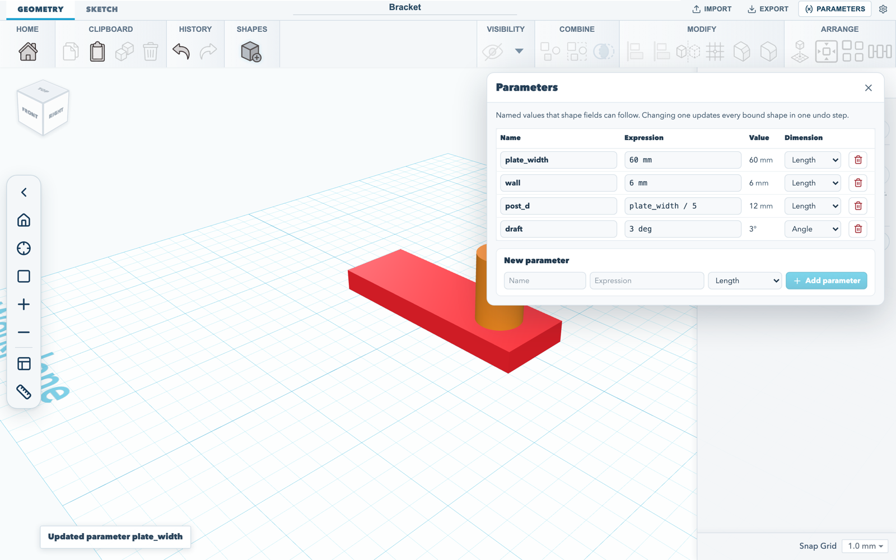
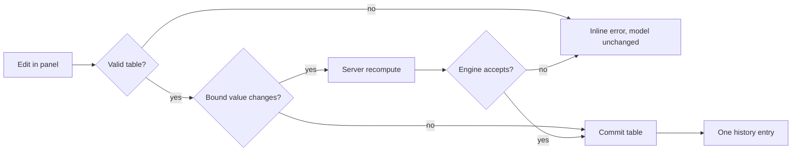
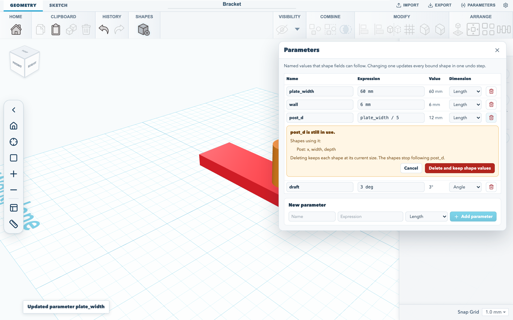
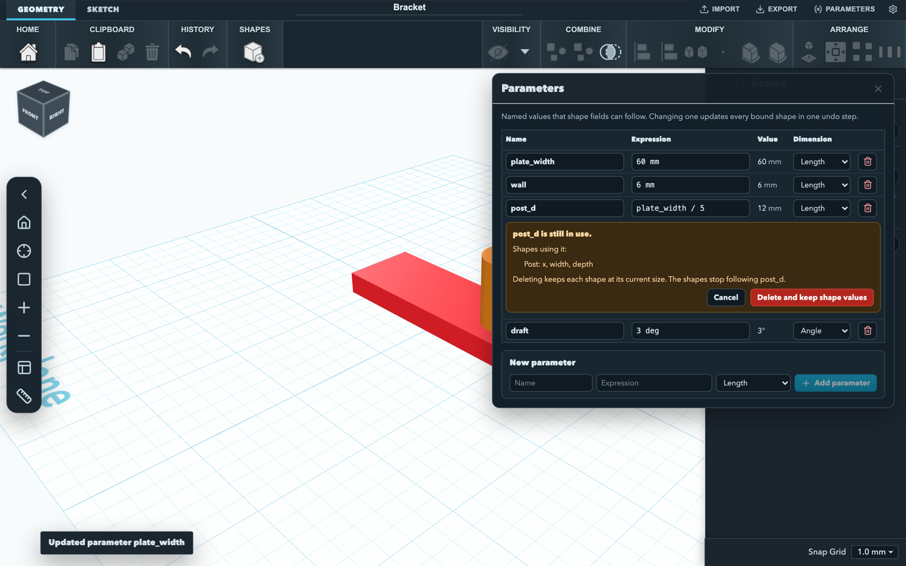

# Edit project parameters

A project can hold a table of named parameters, such as `plate_width = 40 mm`
or `post_d = plate_width / 5`. Shape fields that are bound to a parameter
follow it. This guide covers the **Parameters** panel in the editor.

Fields are bound through the engine package, REST and `.skf` today. Typing an
expression into a dimension field is planned in
[#617](https://github.com/constructorfleet/SketchForge-3D/issues/617).

## Open the panel

Select **Parameters** in the toolbar, next to **Import** and **Export**. Each
row shows the name, the expression, the resolved value with its unit, and the
dimension: **Length** (mm), **Angle** (degrees) or **Unitless**. A bare number
takes the dimension's unit, so `3` in a length parameter is 3 mm.

When the project has an active configuration, the panel edits each parameter's
base expression, and the value column shows the value under the active
configuration. A configuration that overrides a parameter keeps its override. A
rename or delete also updates the configurations.

## Add, edit, rename and delete

- **Add**: type a name and an expression under **New parameter**, choose the
  dimension, and select **Add parameter**.
- **Edit**: change an expression and press <kbd>Enter</kbd> or move focus away.
  Change the dimension in its list. <kbd>Escape</kbd> discards a change you have
  not committed.
- **Rename**: edit the name. Every expression and shape binding that uses the
  old name is rewritten.
- **Delete**: select the bin button for the row.

A name starts with a letter or `_` and has only letters, digits and `_`. Unit
and function names such as `mm` or `max` are reserved.

## Errors leave the model unchanged

An invalid expression, a wrong unit, or a cycle such as `w = half * 2` with
`half = w / 2` is refused. The error shows under the row, the input is marked
invalid, and the table and the geometry stay as they were. Fix the text, or
press <kbd>Escape</kbd> to restore it.

A changed value is also refused when a bound field cannot take it: a value out
of the field's range, a fractional count, or a change to a locked shape. The
message names the shape and the field.

## Bound shapes and undo

A change that alters a parameter's value updates every shape bound to it,
directly or through other parameters. The editor sends the change to the
SketchForge server, which applies it with the same engine code as the REST API.
That includes retained fillets, chamfers, drafts and boolean results.

Each change is one undo step. **Undo** restores the parameter table and the
geometry together, and **Redo** applies both again.

Only the shapes whose bindings use a changed value are sent. If the server
cannot take the request, the message says why: the request is too large, it was
refused, or the server failed. The status line also shows the message, so a
refusal is not lost if you closed the panel while shapes were updating.

The static web build has no server. There the panel edits the table, and bound
placement and size fields on plain primitive shapes, such as a box's width or
position, update in the browser. A change that would rebuild a sketch, a
treatment, a group or an imported shape is refused with a message, and the
model is unchanged.

## Delete a parameter that is in use

When other parameters, configurations or shapes use a parameter, **Delete** shows a warning that
lists them, with the bound fields and sketch constraints of each shape.

- If a parameter or a configuration override uses it, the delete is blocked.
  Change that parameter or override first.
- If only shapes use it, **Delete and keep shape values** removes the parameter
  and the field and constraint bindings that use it. Each shape keeps its current size and stops
  following the parameter. Undo restores the parameter and the bindings.

## Changes from REST or MCP

The open editor does not receive live updates from REST or MCP. Reload the page
to see a parameter change made there. The editor takes the server's table and
undo history when it loads the project, so a later local undo does not revert
the remote change.

## Verified workflow

`tests/browser/parameter-panel.test.mjs` opens a project with a bound box and
checks the inline errors, the recompute, undo and redo, adding, and the delete
warning. `tests/unit/projectParameterEdits.test.ts` and
`tests/unit/editorParameterRoute.test.ts` cover the panel logic and the server
recompute, which is checked by mesh volume and centre.
