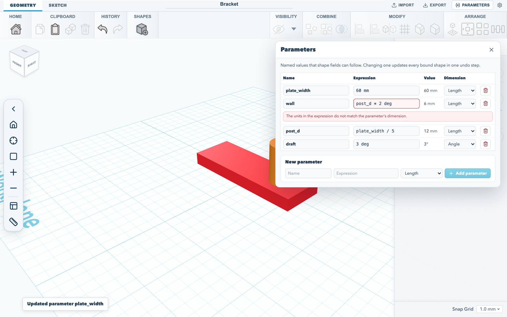
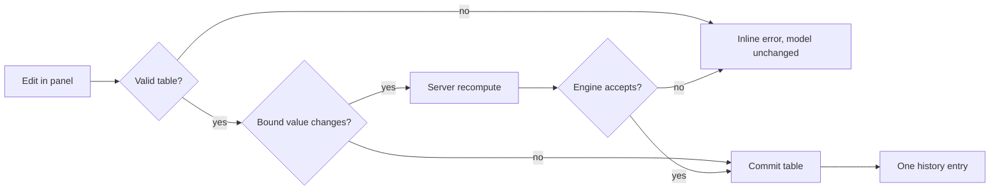
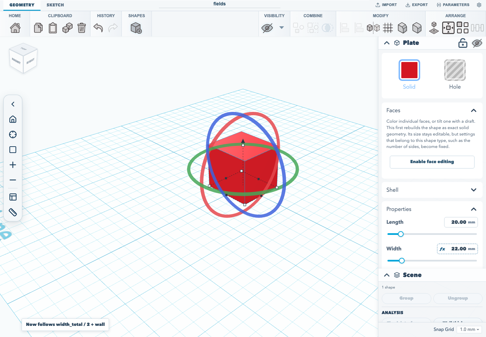
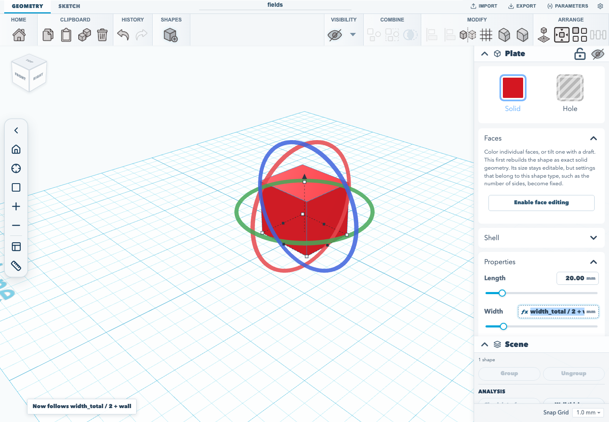
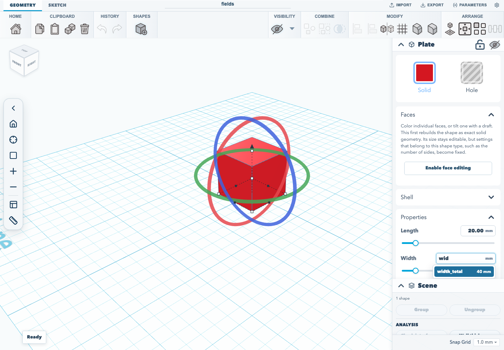
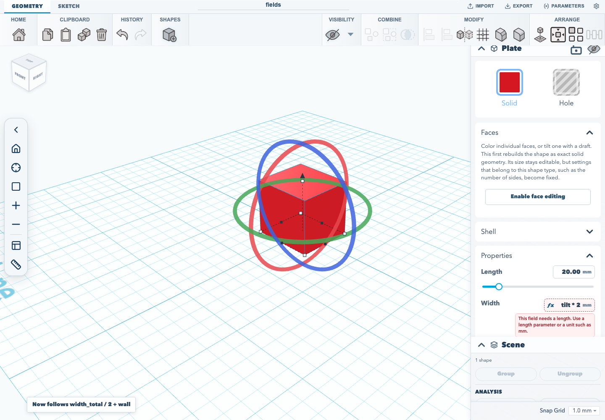
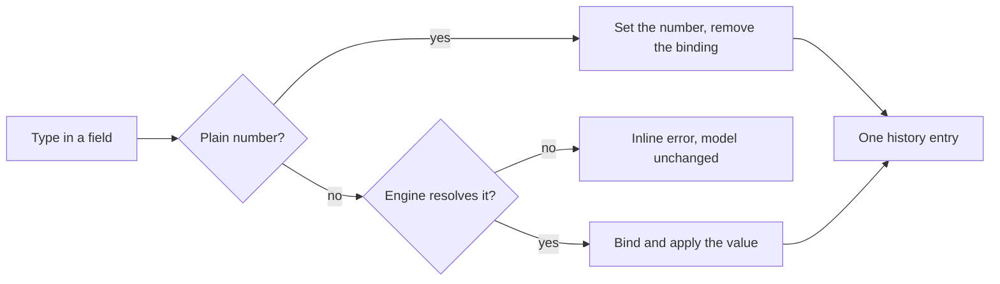

# Edit project parameters

A project can hold a table of named parameters, such as `plate_width = 40 mm`
or `post_d = plate_width / 5`. Shape fields that are bound to a parameter
follow it. This guide covers the **Parameters** panel in the editor, and
typing expressions into dimension fields.

## Open the panel

Select **Parameters** in the toolbar, next to **Import** and **Export**. Each
row shows the name, the expression, the resolved value with its unit, and the
dimension: **Length** (mm), **Angle** (degrees) or **Unitless**. A bare number
takes the dimension's unit, so `3` in a length parameter is 3 mm.

When the project has an active configuration, the panel edits each parameter's
base expression, and the value column shows the value under the active
configuration. A configuration that overrides a parameter keeps its override. A
rename or delete also updates the configurations.

## Add, edit, rename and delete

- **Add**: type a name and an expression under **New parameter**, choose the
  dimension, and select **Add parameter**.
- **Edit**: change an expression and press <kbd>Enter</kbd> or move focus away.
  Change the dimension in its list. <kbd>Escape</kbd> discards a change you have
  not committed.
- **Rename**: edit the name. Every expression and shape binding that uses the
  old name is rewritten.
- **Delete**: select the bin button for the row.

A name starts with a letter or `_` and has only letters, digits and `_`. Unit
and function names such as `mm` or `max` are reserved.

## Errors leave the model unchanged

An invalid expression, a wrong unit, or a cycle such as `w = half * 2` with
`half = w / 2` is refused. The error shows under the row, the input is marked
invalid, and the table and the geometry stay as they were. Fix the text, or
press <kbd>Escape</kbd> to restore it.

A changed value is also refused when a bound field cannot take it: a value out
of the field's range, a fractional count, or a change to a locked shape. The
message names the shape and the field.

## Bound shapes and undo

A change that alters a parameter's value updates every shape bound to it,
directly or through other parameters. The editor sends the change to the
SketchForge server, which applies it with the same engine code as the REST API.
That includes retained fillets, chamfers, drafts and boolean results.

Each change is one undo step. **Undo** restores the parameter table and the
geometry together, and **Redo** applies both again.

Only the shapes whose bindings use a changed value are sent. If the server
cannot take the request, the message says why: the request is too large, it was
refused, or the server failed. The status line also shows the message, so a
refusal is not lost if you closed the panel while shapes were updating.

The static web build has no server. There the panel edits the table, and bound
placement and size fields on plain primitive shapes, such as a box's width or
position, update in the browser. A change that would rebuild a sketch, a
treatment, a group or an imported shape is refused with a message, and the
model is unchanged.

## Delete a parameter that is in use

When other parameters, configurations or shapes use a parameter, **Delete** shows a warning that
lists them, with the bound fields and sketch constraints of each shape.

- If a parameter or a configuration override uses it, the delete is blocked.
  Change that parameter or override first.
- If only shapes use it, **Delete and keep shape values** removes the parameter
  and the field and constraint bindings that use it. Each shape keeps its current size and stops
  following the parameter. Undo restores the parameter and the bindings.

## Type an expression into a dimension field

The number fields in the object panel accept expressions. That includes size
and shape fields such as **Width** or **Sides**, the **Placement** fields
(**X**, **Y**, **Z** and the rotations), and revolve settings. In the sketch
editor, the **Distance**, **Radius**, **Diameter** and **Angle** inputs accept
them too, and so does the value field of each of those constraints in the
constraint list.

- **Bind**: type an expression such as `wall * 2` and press <kbd>Enter</kbd> or
  move focus away. The field follows the expression. It shows the resolved
  value, a dashed border and an **ƒx** mark. Screen readers announce
  "Follows the expression wall * 2" as the field's description.
- **See the expression**: focus the field, or hover over it.
- **Unbind**: type a plain number, such as `25`. The field keeps that number
  and stops following the expression, even when the number is the same as
  the current value.
- **Autocomplete**: while you type a name, a list shows the matching
  parameters with their values. Use <kbd>↑</kbd> and <kbd>↓</kbd> to choose,
  and <kbd>Enter</kbd> or <kbd>Tab</kbd> to insert the name. <kbd>Escape</kbd>
  closes the list. Press <kbd>Escape</kbd> again to discard the entry.

A bare number in an expression takes the field's unit: millimetres for
lengths and degrees for angles. This is also true when the workspace shows
inches. A plain number on its own is a typed value in the unit that the field
shows. To give an expression a different unit, write the unit, for example
`wall + 0.5 in`.

### Errors stay in the field

An expression that does not parse, names an unknown parameter, has the wrong
dimension, or gives a value out of the field's range is refused. The message
shows under the field, the field is marked invalid, and the model does not
change. Correct the text, or press <kbd>Escape</kbd> to restore the field.

A sketch shape can follow expressions in its size or in its sketch
constraints, but not in both. A bound size rescales the sketch, which would
fight a bound constraint. So a constraint expression is refused while the
shape's width or depth follows an expression. For revolves and sweeps, height
counts too. A size expression is refused while a constraint follows one. Clear
one binding first. A plain number is always accepted.

### Undo and later edits

Each bind is one undo step, and so is typing a plain number into a bound
field. **Undo** restores the old value and the old binding together.

A bound value that you change in any other way also stops following its
expression. Examples are dragging the shape, the gizmo, a slider, the arrow
keys, align, and typing a number. Without this, the next parameter change would
move the shape back.

This also applies to rebuilds. Changing a revolve's sweep moves the centre of
its bounding box, so it changes the shape's X and Z and drops any X or Z
binding. Bindings whose numbers the rebuild leaves alone are kept.

The engine resolves and applies the value on the SketchForge server, as for a
parameter change. In the static web build, size and placement fields on
plain primitive shapes bind in the browser. A field that needs a rebuild,
such as a revolve setting, is refused there with a message. Sketch constraint
values bind in the sketch editor in both builds. The sketch is rebuilt when
you finish it.

Not covered yet: the edge treatment, draft and shell inputs, and the numbers
you type during a drag.

## Changes from REST or MCP

The open editor does not receive live updates from REST or MCP. Reload the page
to see a parameter change made there. The editor takes the server's table and
undo history when it loads the project, so a later local undo does not revert
the remote change.

## Verified workflow

`tests/browser/parameter-panel.test.mjs` opens a project with a bound box and
checks the inline errors, the recompute, undo and redo, adding, and the delete
warning. `tests/unit/projectParameterEdits.test.ts` and
`tests/unit/editorParameterRoute.test.ts` cover the panel logic and the server
recompute, which is checked by mesh volume and centre.

`tests/browser/expression-fields.test.mjs` binds the width and placement of a
box and a sketch distance constraint. It checks autocomplete, the inline error,
undo and redo, unbinding by typing a number, and that a keyboard nudge and a
slider move remove the binding. `tests/unit/expressionFields.test.ts` covers
the entry rules, and `tests/unit/editorParameterRoute.test.ts` covers the
server bind, which is checked by mesh volume and centre.
