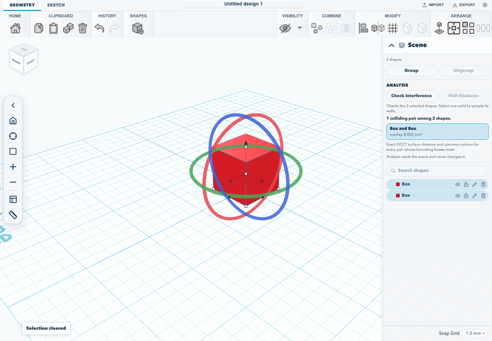
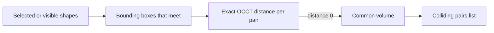

# Interference and wall thickness

The **Analysis** section of the scene list checks whether parts collide and
estimates how thin a part's walls get. Both checks only read the scene: they
never move, resize or rebuild a shape, and they add nothing to undo history.
Undo after a check takes back whatever you did before it.

Both run on the CAD kernel the editor already loads for fillets and exact cuts,
in the browser, so they work without a server and on unsaved changes. They use
the same code as the REST API's
[`POST /interference`](/docs/REST_API.md#checking-interference-across-a-scene)
and `GET /thickness`, so the editor and the API give the same answer for the
same shapes.

## Check interference

Press **Check interference**. With two or more shapes selected, it checks the
selected shapes; otherwise it checks every visible shape in the scene. The note
under the buttons says which. Hidden shapes and holes are never checked.

Each pair of shapes that touches or overlaps is listed, with the volume they
share in mm³, or **touching** when they meet without overlapping. A pair marked
**from triangles** involves a shape that has no exact solid, such as an
imported STL or a mirrored primitive, so the kernel measured its triangles
rather than a true surface. Click a pair to select both of its shapes; that
highlights them in the view and in the scene list. Selecting is not an edit.

The bounding-box step only skips pairs that cannot touch. Every pair it keeps
is measured exactly, so two round posts whose boxes overlap but whose surfaces
do not are not reported. This is not the approximation that the MCP
`validate_scene` tool reports, which compares bounding boxes only.

### When a check is refused

A check covers at most 128 shapes, and at most 512 pairs whose bounding boxes
meet. Past either limit the whole check is refused rather than half-done, and
the panel says which limit was reached and how many were asked for. Select
fewer shapes and check again. The REST API refuses with the same limits.

## Wall thickness

Select one solid and press **Wall thickness**. The panel reports the thinnest
wall it found, in millimetres, and states how it was measured: a 5 × 5 grid of
sample points on every face (25 per face), each measured to the facing surface
on the opposite side. This is a screening estimate, not a certified minimum: a
wall that is thinnest between two sample points can read thicker than it is.
Shapes with more than 256 faces are refused. A shape with no opposing faces,
such as a sphere, reports that no wall was found.

## When a result goes stale

A result describes the shapes as they were when it ran. Edit, move or delete a
shape it measured and the panel says the scene has changed; run the check
again for a current answer.
