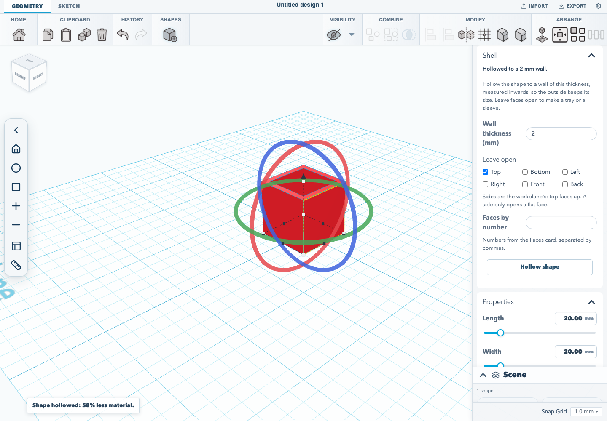

# Shells and trays

A solid 20 mm cube costs about twice the filament of the same cube with a 2 mm
wall, and the same cube with its top left open is a tray. The **Shell** card in
the shape inspector does both: it hollows the selected shape to a wall of the
thickness you give, and leaves any faces you choose open.

## Hollow a shape

1. Select one shape and open the **Shell** card in the inspector.
2. Type the **Wall thickness**, in the workspace's length unit. The wall is
   measured inwards, so the shape keeps its outside size.
3. Under **Leave open**, tick the sides to leave off: **Top**, **Bottom**,
   **Left**, **Right**, **Front** or **Back**. Leave them all unticked for a
   sealed hollow, a wall all the way round with the void closed in.
4. Press **Hollow shape**.

The notice says how much material went. The shape keeps its place and size,
and stores the exact solid alongside its mesh, the same as a fillet. A
hollowed part still exports to STEP as true surfaces. After hollowing, the card
shows the wall the shape was hollowed to.

Sides are the workplane's: **Top** faces up and **Front** faces the viewer, as
in the view cube. A side means the outermost flat face pointing that way, so on
a part that is already hollow, **Top** opens the lid, not the floor of the
cavity. A shape with no flat face on that side, such as a sphere, a torus or a
pointed cone, is refused rather than opening the wrong face. It can still be
hollowed sealed.

## Choose faces by number

A face no side describes, such as one wall of a hexagonal pot, can be named by
number. When the shape has exact faces (it was filleted, drafted or imported
from STEP, or **Enable face editing** was pressed in the **Faces** card), the
**Shell** card adds **Faces by number**. Type the face numbers the **Faces**
card shows, separated by commas. To pick a face, open the **Faces** card and
click the face in the view. The **Shell** card then offers **Add picked face**
with its number. Sides and numbers can be mixed.

A shape's faces change when it is hollowed, so its face numbers change too.
Pick again before naming faces on a hollowed shape.

## What it refuses

Every refusal leaves the shape as it was, and says why in a notice:

| Notice | When |
| --- | --- |
| The wall is too thick | Hollowing at that thickness leaves no cavity. Try a thinner wall. |
| Every face open | Leaving every face open would take the walls away rather than hollow anything. |
| No flat face on that side | The shape has no flat face pointing that way to leave open. |
| Surfaces cannot be offset | The skin is a spline, not an analytic surface: a ball with unequal radii, a pointed cone, a tube, ring, round roof or loft. Cut a cavity with a hole shape instead. |
| More than one closed surface | The shape is already a sealed hollow, or its mesh has an internal void or separate bodies. Shell it before sealing, or shell each body on its own. |
| Fillet, chamfer or draft | The shape carries an edge treatment or draft. Undo it, hollow the shape, then treat it again. |
| Cannot be hollowed exactly | The shape has no exact surfaces to offset: text, a gear, an icosahedron, a mirrored primitive, a group of loose parts, or a plain imported mesh. |

These are the same refusals the REST API gives for
[`POST /shell`](../REST_API.md#hollowing-a-solid-shells-and-trays). The editor
runs the same shell code in its CAD worker, so a part hollowed in the browser
and over the API come out the same.

## Undo, saving and sketches

- **Undo and redo:** hollowing is one undoable step. Undo puts the solid back
  with its faces, face colours and face IDs; redo hollows it again.
- **Saving:** the hollowed solid, its mesh and a record of the shell (wall
  thickness and open faces) are saved in the project and in `.skf` files, and
  come back when the project is opened.
- **Face colours:** hollowing makes new faces with new face IDs, so face
  colours on the shape are cleared.
- **Sketches:** nothing can replay a shell on a rebuilt solid. Finishing an
  edit to the sketch of a hollowed extrusion, sweep or revolve is refused, and
  the sketch stays open to cancel. Undo the shell first to edit the sketch.
- **Groups:** a group of loose parts cannot be hollowed. Hollow its parts one
  at a time. Hole shapes do not show the card.

## Verified workflow

`tests/browser/shell-tray.test.mjs` adds a box, gives it a material so the
inspector shows its volume, and checks that a wall as thick as the box is
refused with a notice and leaves the volume alone. It then hollows the box to
a 2 mm wall with **Top** open and checks the volume dropped to exactly the
tray's (20³ − 16 × 16 × 18 mm³), with the outside size unchanged. It undoes
and redoes the shell, saves the project as `.skf`, opens it again and checks
the tray and its shell record came back. The size readouts cannot tell a
hollow from a solid, so the test measures volume.

`tests/unit/editorShell.test.ts` hollows shapes the way the editor's CAD worker
does and checks each result by volume and centre of mass. A tray's weight sits
lower than a sealed hollow's, and a shape away from the origin is hollowed
where it stands. It also covers the localized refusals, the request the
inspector sends, and the shell record through a `.skf` save and load.
