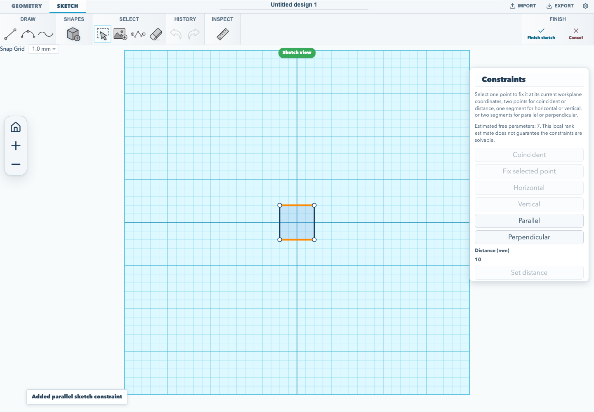
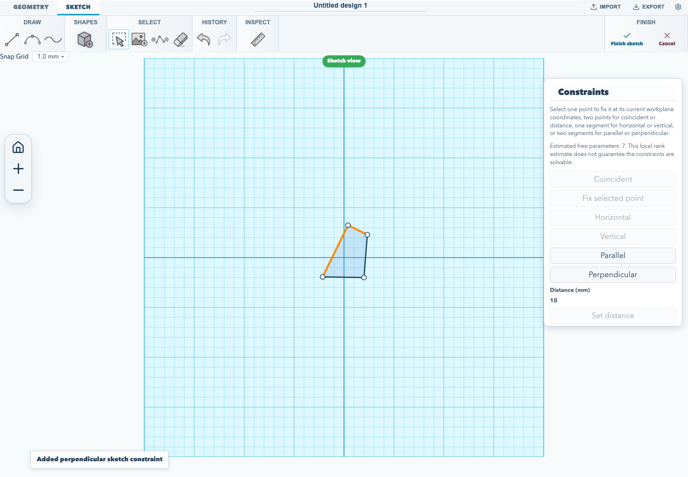

# Constrain sketch geometry

Sketch constraints relate selected entities while you edit a sketch. This guide
shows **Parallel**, **Perpendicular**, and **Tangent** constraints.

## Make two segments parallel

1. Create a sketch with at least two line segments, or edit a rectangular
   sketch.
2. Select the two segments. For the rectangle, drag a selection marquee over
   the two opposite vertical sides.
3. Choose **Parallel** in the sketch constraint toolbar.

The constraint aligns the segments' directions. It does not move the segments
to the same line or change their offset, so the opposite sides stay separated.
The workflow below checks that the two segments are selected, applies the
constraint, and confirms the resulting constraint in the editor.



## Make two segments perpendicular

1. Create a rectangular sketch and choose **Edit sketch**.
2. Drag one corner so the two adjoining sides no longer meet at 90 degrees.
3. Drag a selection marquee around the midpoints of those two adjoining sides.
4. Choose **Perpendicular** in the sketch constraint toolbar.

The constraint solver adjusts the selected segments until they meet at 90 degrees.
The browser acceptance flow checks the initial angle, applies the relation, and
measures the resulting angle before capturing the editor state.



## Make a line tangent to a Bezier

1. Draw a line and a Bezier segment that meet at one endpoint. Give the Bezier
   endpoint a control handle.
2. Select the line and Bezier segment together.
3. Choose **Tangent** in the sketch constraint toolbar.

The solver keeps the line direction aligned with the Bezier's endpoint handle
while the shared point moves. The relation removes one estimated degree of
freedom. The segments must share exactly one endpoint; tangent constraints
between unsupported segment types are refused when a `.skf` project is read.

Run the browser acceptance flow with:

<!-- runnable-exempt: This command runs the browser acceptance workflow; its maintained implementation is tests/browser/sketch-parallel-constraint.test.mjs. -->
```sh
npm run test:browser
```

For the full create-and-export walkthrough, see [make and export your first
model](./editor-quickstart.md). For constraints on solid faces, see the
[face-drafting guide](./face-drafting.md).
