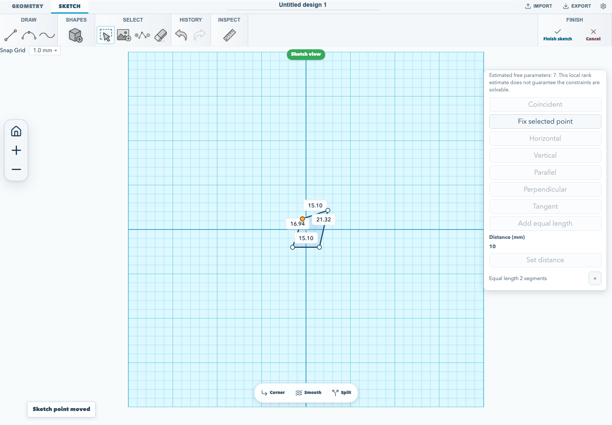
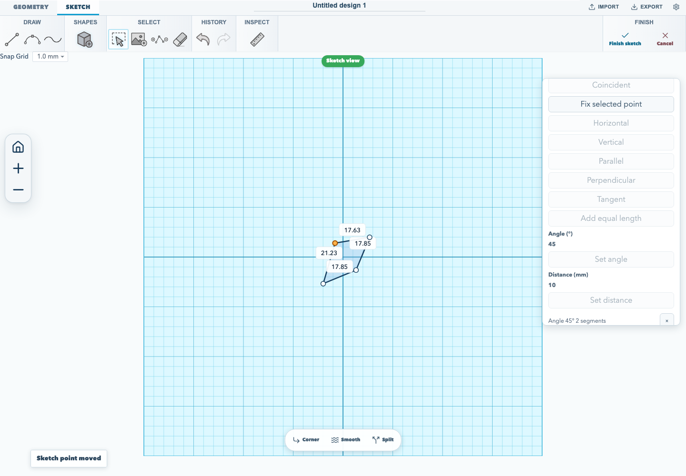
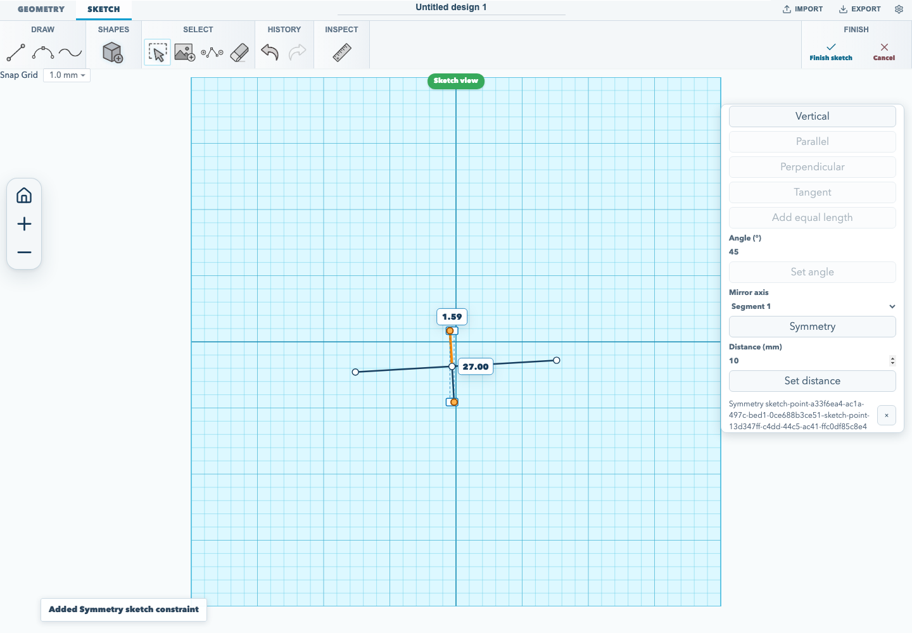
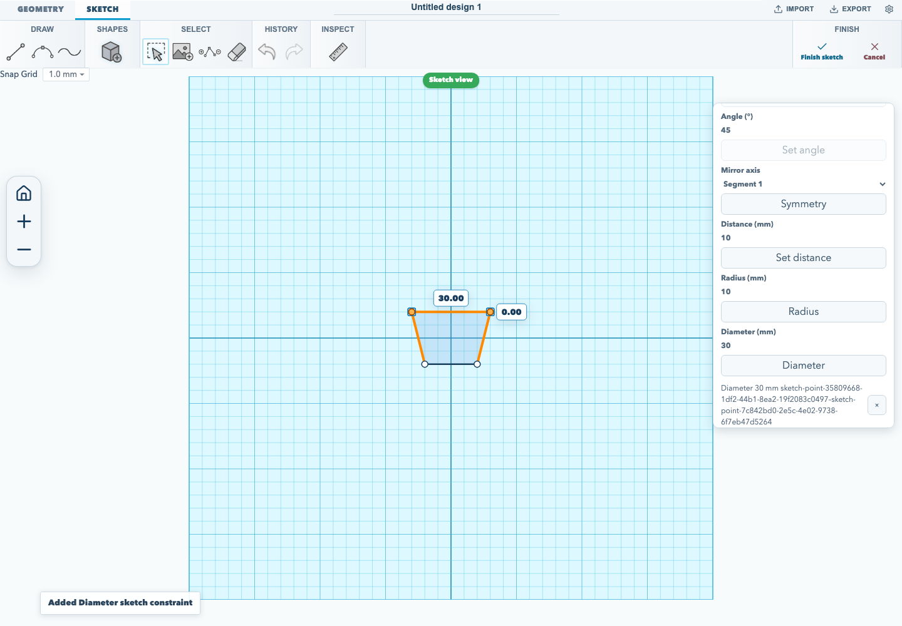

# Constrain sketch geometry

Sketch constraints relate selected entities while you edit a sketch. This guide
shows **Parallel**, **Perpendicular**, **Tangent**, **Equal length**,
**Angle**, **Symmetry**, and **Radius / Diameter** constraints.

## Make two segments parallel

1. Create a sketch with at least two line segments, or edit a rectangular
   sketch.
2. Select the two segments. For the rectangle, drag a selection marquee over
   the two opposite vertical sides.
3. Choose **Parallel** in the sketch constraint toolbar.

The constraint aligns the segments' directions. It does not move the segments
to the same line or change their offset, so the opposite sides stay separated.
The workflow below checks that the two segments are selected, applies the
constraint, and confirms the resulting constraint in the editor.


## Make two segments perpendicular

1. Create a rectangular sketch and choose **Edit sketch**.
2. Drag one corner so the two adjoining sides no longer meet at 90 degrees.
3. Drag a selection marquee around the midpoints of those two adjoining sides.
4. Choose **Perpendicular** in the sketch constraint toolbar.

The constraint solver adjusts the selected segments until they meet at 90 degrees.
The browser acceptance flow checks the initial angle, applies the relation, and
measures the resulting angle before capturing the editor state.


## Make two segments equal in length

1. Create a sketch with two non-zero-length line segments.
2. Select both line segments.
3. Choose **Equal length** in the sketch constraint toolbar.

The solver adjusts the segments so their lengths match while preserving any
anchored point. This relation removes one estimated degree of freedom and is
stored in `.skf` projects. Curves and zero-length lines are not eligible.



## Set the angle between two segments

1. Create a sketch with two non-zero-length segments.
2. Select both segments.
3. Enter the angle in degrees and choose **Set angle**.

The solver turns the second segment around the anchored geometry until the
unsigned angle between the two segments matches the value. The angle is measured
from 0° to 180°, so 90° is the same relation as **Perpendicular**; use whichever
name fits the design. The relation removes one estimated degree of freedom and
is stored in `.skf` projects. A zero-length segment is refused, and the angle
must stay between 0° and 180°.



## Make two points symmetric about a line

1. Draw the line you want to use as the mirror axis, then draw or place the two
   points that should mirror across it.
2. Select the two points. Choose the axis in the **Mirror axis** list — the
   first non-zero-length segment is selected by default.
3. Choose **Symmetry**.

The solver puts the points' midpoint on the axis and turns the line between them
perpendicular to the axis, so the two points end up the same distance from it on
opposite sides. The relation removes two estimated degrees of freedom and is
stored in `.skf` projects. A zero-length axis or two identical points are
refused.



## Set a radius or diameter

1. Select two points that sit at opposite ends of the diameter. For a circle
   primitive, drag a narrow selection band through the centre so only one pair
   of opposite rim points is selected.
2. Enter the **Radius (mm)** or **Diameter (mm)** value.
3. Choose **Radius** or **Diameter**.

**Radius** keeps the distance between the two points at twice the entered
value; **Diameter** keeps it at the entered value. The relation removes one
estimated degree of freedom and is stored in `.skf` projects. The two points
must be different and the value must be greater than zero. For a circle, use
**Diameter** on two opposite rim points to set its size directly.



## Make a line tangent to a Bezier

1. Draw a line and a Bezier segment that meet at one endpoint. Give the Bezier
   endpoint a control handle.
2. Select the line and Bezier segment together.
3. Choose **Tangent** in the sketch constraint toolbar.

The solver keeps the line direction aligned with the Bezier's endpoint handle
while the shared point moves. The relation removes one estimated degree of
freedom. The segments must share exactly one endpoint; tangent constraints
between unsupported segment types are refused when a `.skf` project is read.

Run the browser acceptance flow with:

<!-- runnable-exempt: This command runs the browser acceptance workflow; its maintained implementation is tests/browser/sketch-equal-length-constraint.test.mjs. -->
```sh
npm run test:browser
```

For the full create-and-export walkthrough, see [make and export your first
model](./editor-quickstart.md). For constraints on solid faces, see the
[face-drafting guide](./face-drafting.md).
