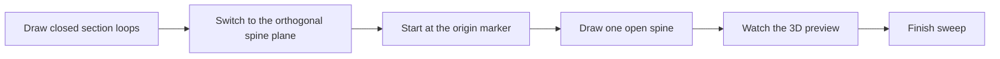
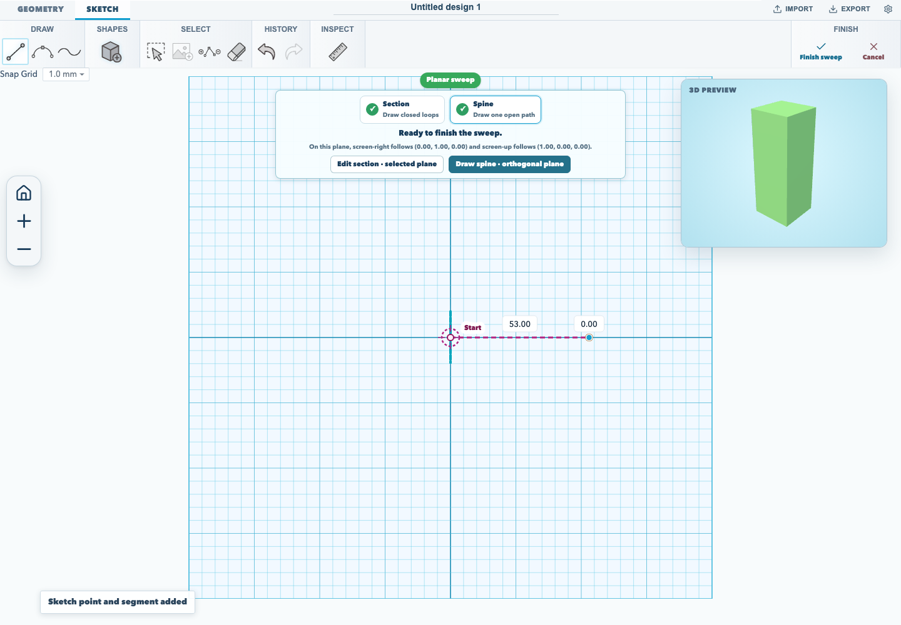

# Sweep a sketch section along a spine

A sweep moves a closed section along an open spine. The section is drawn on one
workplane and the spine on an orthogonal plane derived from it, so you can build
pipes, rails, and bent extrusions from two ordinary sketches.

## 1. Draw the section

1. Open the **Sketch** tab and choose **Sketch to 3D options** → **Sweep sketch**.
2. Draw and close one or more loops on the selected workplane. Adding a
   rectangle, circle, or polygon closes the section immediately.
3. The editor switches to the spine plane as soon as a loop closes. You can
   return with **Edit section · selected plane** to add more loops; nested loops
   become through-holes, and disjoint loops become separate solids.

The step panel shows **Section** with a tick once a closed loop exists.

## 2. Draw the spine from the start marker

The sweep starts at the section origin. When the spine stage begins, the editor
places the first spine point there and draws a crosshair labelled **Start**.
That point is pinned: dragging it shows *"The sweep starts at the section origin,
so that point stays put"* instead of moving the sweep.

1. Draw from the start marker. The first segment snaps to screen-right, which is
   the section normal, so the section stays perpendicular to the initial tangent.
2. Add bends by clicking further points. Later segments are free.
3. Select a spine point to set its **3D depth (mm)** and move it out of the
   spine plane. Cubic handles have their own incoming and outgoing depth.

The step panel shows **Spine** with a tick once the open path exists, and
**Finish sweep** stays disabled until a closed section and exactly one spine are
present. Its tooltip says what is missing.

## 3. Watch the 3D preview

A **3D preview** inset draws the swept solid while you are still editing the
sketch. It updates shortly after each section or spine change, so a wrong
direction, a missing hole, or an unexpected twist is visible before you finish.

## Centre an off-origin section

The sweep starts at the section origin, not at the middle of wherever the
section happens to be drawn. If the section's bounds are off the origin, the
step panel says how far and offers **Centre section**. That moves the section
loops and any fixed constraints onto the origin in one undoable step.

## Limits

- A sweep needs at least one closed section loop and exactly one open spine.
- The first spine segment must follow screen-right; otherwise the editor refuses
  the sweep and asks you to redraw it.
- The generated solid is baked. Editing the source sketch rebuilds it, but it is
  not a general feature-history node.

The browser acceptance test for this workflow is
[`tests/browser/sketch-sweep-ux.test.mjs`](../../tests/browser/sketch-sweep-ux.test.mjs).
