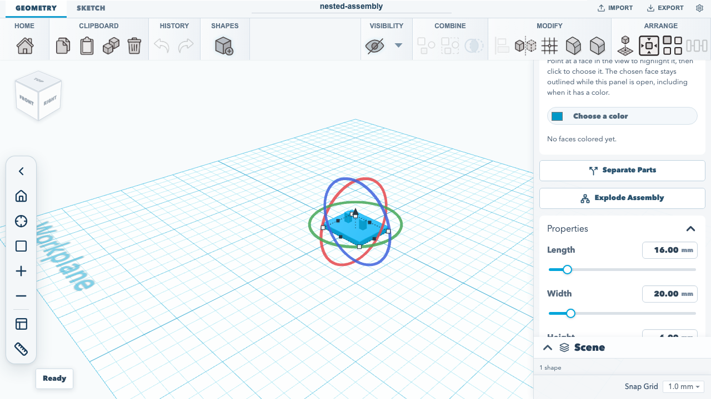
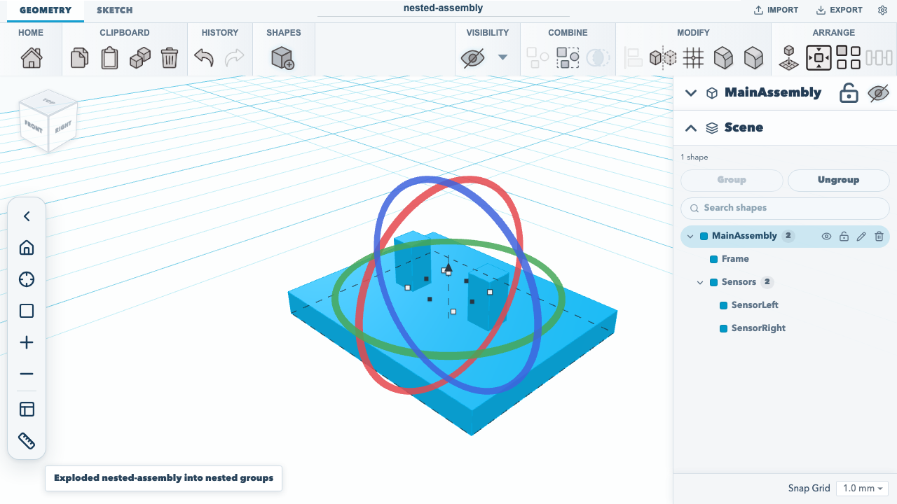
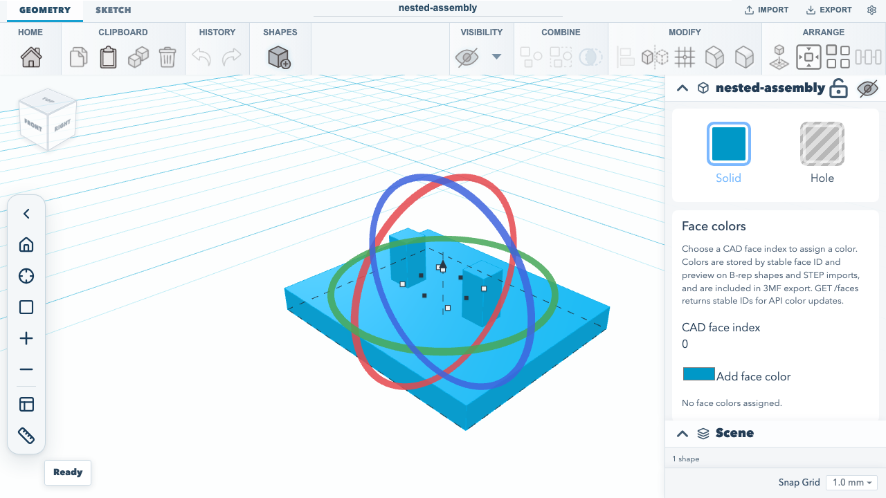

# Working with STEP assemblies

A STEP assembly imported in the editor begins as one positioned mesh. The editor retains the source STEP file as a project asset, so it remains available when the project is saved or exported as `.skf`. When the source is within the bounded metadata extraction limits, the shape summary includes `stepAssembly`: a product tree with names, optional source occurrence IDs, and direct children. This tree describes the source assembly; it does not itself create selectable parts. See the [editor project export walkthrough](./editor-quickstart.md).

## Export nested groups as STEP assemblies

Exporting a grouped project writes an XCAF product and occurrence for each project group level. Other CAD readers can inspect the hierarchy through native `NEXT_ASSEMBLY_USAGE_OCCURRENCE` relationships; group paths are no longer packed into component names. Reimport reads those nested XCAF labels and retains the same group tree for explosion. Exact solid placements and colors remain attached to their leaf components.

Imported STEP component placements are not directly editable as occurrence transforms. To reposition a subassembly in SketchForge, explode it into project groups and move the group; STEP export writes the resulting group hierarchy and placement.

## Explode an assembly in the editor

Select an imported STEP assembly whose shape carries `stepAssembly` metadata, and the shape inspector offers **Explode Assembly**. The editor explodes it on the same browser CAD kernel that imported it, using the project's retained STEP source, so no server or API token is involved. The imported mesh is replaced, in its place in the scene, by nested groups matching the source product tree; expand a group in the scene inspector to see its members. The explosion is one undo step: **Undo** returns the single imported assembly, and **Redo** brings the groups back.





When the product tree cannot be matched unambiguously to the exact solids, the editor uses the same fallback as REST and MCP below: the assembly becomes flat, top-level solids, and a notice says the structure could not be matched rather than reporting nested groups. A locked shape, a project that no longer holds the STEP source, a file with a single solid, and the source size and solid limits below are refused with a notice and leave the scene unchanged. The browser test `an imported STEP assembly explodes into nested groups from the shape inspector, as one undo step` in the [editor workflow test](https://github.com/constructorfleet/SketchForge-3D/blob/main/tests/browser/editor-quickstart.test.mjs) imports the checked-in fixture, explodes it from the inspector, checks the nested `MainAssembly` → `Frame`/`Sensors` → `SensorLeft`/`SensorRight` rows in the scene inspector, and steps undo and redo.

Saving and `.skf` export keep the exploded groups and each leaf's exact geometry and `stepComponent` metadata. The original STEP source stays in the project, and `.skf` export keeps it while any exported undo state still refers to it, so undoing back to the imported assembly still has its source. The exploded leaves do not reference the source; each carries its own exact solid.

## Explode through REST or local MCP

The REST `POST /api/v1/imports` endpoint accepts STL, OBJ, and SVG uploads; it does not accept STEP and there is no REST upload path for a STEP source asset. REST `POST /api/v1/explode?projectId=...&shapeId=...` only operates on a STEP-backed shape whose source asset is already present in the server-side project. The endpoint does not upload or import that asset. See the [REST API reference](/docs/REST_API.md) for the API's server-side project boundary.

For a supported editor-to-local workflow, import the STEP assembly in the editor, export the project as `.skf`, then use local MCP `sketchforge_import_project` to load that package and `sketchforge_explode_step_assembly` with the returned project ID and shape ID. Both tools run against local project files; see the [MCP tools reference](../mcp/TOOLS_REFERENCE.md#sketchforgeimportproject) and [MCP bridge setup](../../packages/sketchforge-client/README.md#the-mcp-bridge).

Browser acceptance in the [editor workflow test](https://github.com/constructorfleet/SketchForge-3D/blob/main/tests/browser/editor-quickstart.test.mjs) imports the checked-in STEP fixture in the editor, saves the actual `.skf` download, and passes that exact file through local MCP project import and assembly explosion. It verifies the nested `MainAssembly` → `Frame`/`Sensors` → `SensorLeft`/`SensorRight` groups, exact per-leaf occurrence IDs, and each complete ordered root-to-leaf path, then removes its temporary files. The test captures the imported result below; run it with `npm run test:browser`.



The underlying `.skf` import and local MCP steps are also exercised by the [local MCP integration test](https://github.com/constructorfleet/SketchForge-3D/blob/main/tests/unit/localMcpEngine.test.ts), which builds a package from the checked-in [nested assembly STEP fixture](https://github.com/constructorfleet/SketchForge-3D/blob/main/tests/fixtures/step/nested-assembly.step). The local MCP tools are implemented in [`localEngine.mjs`](https://github.com/constructorfleet/SketchForge-3D/blob/main/packages/sketchforge-client/mcp/localEngine.mjs), and the server STEP explosion is handled by [`serverStepExplode.ts`](https://github.com/constructorfleet/SketchForge-3D/blob/main/packages/sketchforge-engine/src/serverStepExplode.ts), which runs the same [`stepAssemblyExplode.ts`](https://github.com/constructorfleet/SketchForge-3D/blob/main/packages/sketchforge-engine/src/stepAssemblyExplode.ts) the editor runs, on the server kernel. Run the focused test with `npm test -- tests/unit/localMcpEngine.test.ts -t 'STEP-backed SKF'`.

When every exact solid can be associated with a unique product occurrence, explosion replaces the imported mesh with nested project groups matching the source product tree. Each leaf keeps its exact solid geometry, available component color, and `stepComponent` metadata:

```json
{
  "id": "step-occurrence:#42/solid-1",
  "occurrenceId": "step-occurrence:#42",
  "path": [
    { "id": "step-node:0", "name": "MainAssembly" },
    { "id": "step-occurrence:#19", "name": "Sensors" },
    { "id": "step-occurrence:#42", "name": "SensorLeft" }
  ]
}
```

`id` identifies a solid within its source occurrence, `occurrenceId` identifies the product occurrence, and `path` records the root-to-component ancestry. These are descriptive source identifiers: changing the STEP file or its product structure can change them. The nested groups and leaf metadata persist through normal project save and `.skf` round-trip. Select a group to move its complete subassembly; ungroup one level at a time to work with its children or individual solids.

Hierarchy-to-solid association is bounded and conservative. It compares world-space bounds from the XCAF GLB occurrence meshes with exact imported solid bounds, and uses a match only when both sides are unique. If any solid cannot be associated unambiguously, the operation falls back to the existing flat, top-level solids rather than creating a partial tree; those solids keep the name and color available from XCAF, and `stepComponent` may be absent. Nested groups retain the component positions in project space. They do not preserve the STEP file's original transform operations.

Extraction remains limited to STEP sources up to 8 MiB and 200 solids; hierarchy metadata has a 2,000-node and 32-level bound. REST request and response details are in the [generated operation references](/docs/rest-api/).
